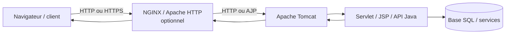
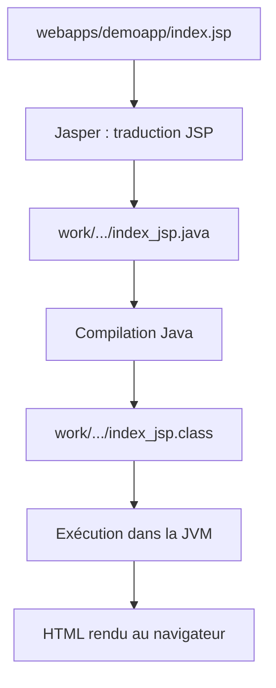
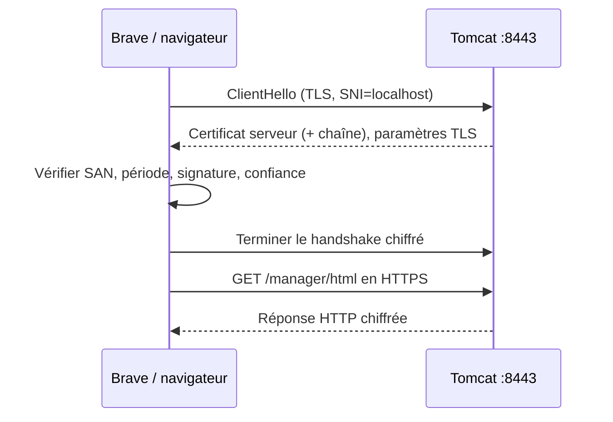
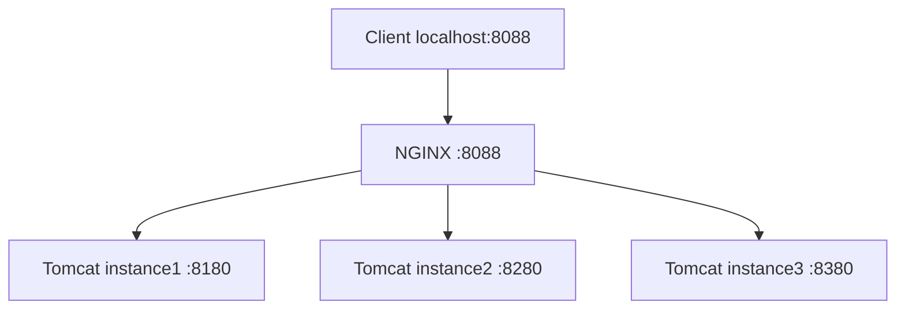
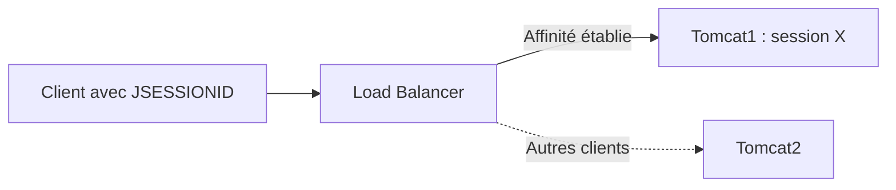
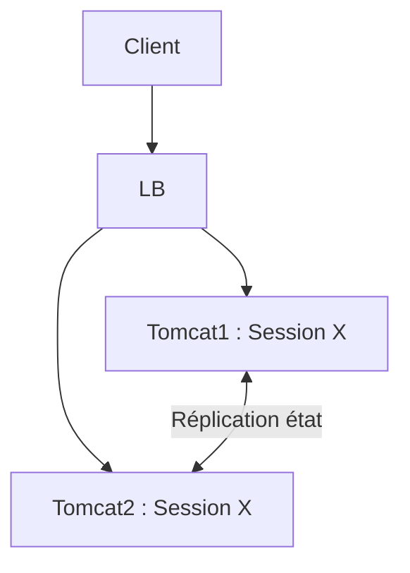
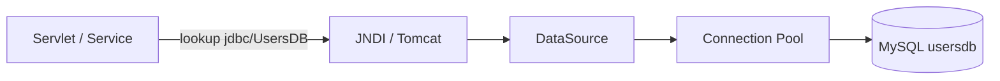
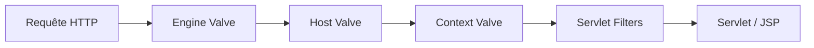
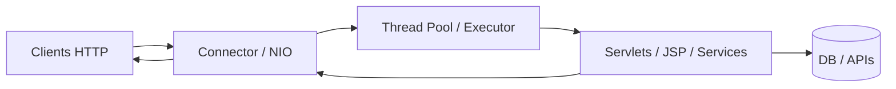
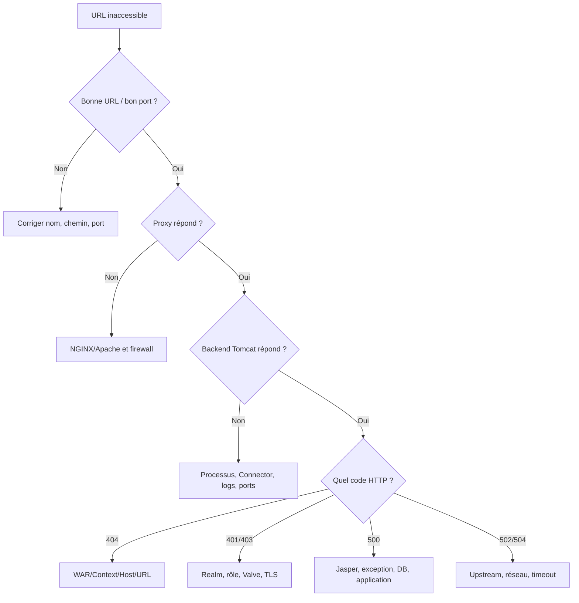

# Apache Tomcat 9 — Guide complet, cours et travaux pratiques

> **De l'installation à l'administration, HTTPS, clustering, sécurité, logging et performance**  
> Guide en français — termes techniques en anglais — Linux Pop!_OS / Ubuntu — Java 21  
> **Édition : 17 novembre 2026** · Référence principale : **Apache Tomcat 9.0.124**

---

## Avant-propos

Ce guide reprend **les 15 premières sections** de la formation Udemy *Apache Tomcat Server from Beginners to Advanced*, les captures, discussions et fichiers de démonstration étudiés ensemble. Les exemples Windows de la formation sont traduits en exercices **Linux / Pop!_OS** et complétés par des explications d'architecture, des outils de diagnostic et des bonnes pratiques.

**Légende utilisée :**

- **[FORMATION]** : notion ou manipulation présentée par le formateur, parfois avec ses valeurs historiques.
- **[LABO]** : exercice reproductible sur ton environnement ; changer les valeurs adaptées à ta machine.
- **[BONNE PRATIQUE]** : amélioration ou recommandation qui dépasse la démonstration du cours.
- **[ATTENTION]** : risque de sécurité, incompatibilité, hypothèse ou erreur fréquente.

Les exemples marqués **« schéma »** expliquent la structure ; les exemples marqués **« configuration à appliquer »** sont des blocs complets ou insérables. **Ne remplace jamais un `server.xml` de production par un exemple isolé.** Sauvegarder avant toute modification, tester en UAT et préparer un retour arrière.

### Ton environnement de référence

| Composant | Valeur connue dans ton labo |
|---|---|
| Système | Pop!_OS / Linux, utilisateur `anweress` |
| Java | OpenJDK **21** |
| Tomcat | **9.0.124** |
| Installation partagée (`CATALINA_HOME`) | `/home/anweress/apps/tomcat9` |
| Instances (`CATALINA_BASE`) | `~/apps/instance1`, `~/apps/instance2`, `~/apps/instance3` |
| Scripts | `~/apps/scripts/` |
| Load Balancer de labo | NGINX sur `8088` ; backends Tomcat `8180`, `8280`, `8380` |
| Autres outils étudiés | Apache HTTP Server, `mod_jk`, MySQL/MariaDB, OpenSSL, `keytool`, JConsole/VisualVM |

Les IP `192.168.0.x` des captures Udemy sont **des exemples historiques de la formation** : elles ne décrivent pas nécessairement ton réseau. Sur un seul PC, les tests utilisent `127.0.0.1` et des ports différents.

### Sommaire cliquable (15 sections du cours + compléments)

| Partie | Chapitre | Ce que tu sauras faire |
|---|---|---|
| [01](#s01) | Overview of Tomcat | Situer Tomcat dans une architecture Java Web |
| [02](#s02) | Setting up Webserver | Installer, lancer et configurer le runtime |
| [03](#s03) | Application Deployment | Déployer WAR, JSP, Servlet, Manager |
| [04](#s04) | Security and SSL | Configurer TLS, Keystore, Truststore et redirection HTTPS |
| [05](#s05) | Virtual Hosts | Héberger plusieurs applications par nom de domaine |
| [06](#s06) | High-Availability Clustering | Gérer plusieurs instances `CATALINA_BASE` |
| [07](#s07) | NGINX Load Balancing | Configurer reverse proxy et répartiteur HTTP |
| [08](#s08) | Apache HTTP & MOD_JK | Comprendre AJP, workers et `jvmRoute` |
| [09](#s09) | Session Management in Cluster | Sticky Sessions et Session Replication |
| [10](#s10) | JNDI & JDBC Connection Pooling | Configurer DataSource et pool MySQL |
| [11](#s11) | Custom Error Pages | Traiter HTTP 404/500 proprement |
| [12](#s12) | HTTP Request Interception Using Valves | Filtrer les IP par Context, Host, Engine |
| [13](#s13) | Realms and Container Managed Authentication | Protéger les applications et les rôles |
| [14](#s14) | Tomcat Logging | Lire les journaux, configurer JULI |
| [15](#s15) | Performance Tuning | Monitoring, Executors, Heap et Compression |
| [16](#s16) | TP intégrateur | Construire un petit environnement de bout en bout |
| [17](#s17) | Exploitation et troubleshooting | Diagnostiquer les incidents réels |
| [18](#s18) | Bonnes pratiques / corrections du cours | Éviter les erreurs de démonstration |
| [19](#s19) | Fiches mémo et glossaire | Retrouver rapidement une commande |
| [20](#s20) | Sources et références | Documentation de référence vérifiée |

---

<a id="s01"></a>

# 01. Overview of Tomcat — Comprendre l'architecture

## 1.1 Qu'est-ce qu'Apache Tomcat ?

**Apache Tomcat** est un **Servlet Container** et un serveur HTTP capable d'exécuter des applications Web Java. Il fournit l'implémentation des API **Servlet**, **JSP (JavaServer Pages)**, WebSocket et des composants nécessaires à l'exécution d'applications Java Web. Tomcat 9 utilise les espaces de noms Java EE historiques **`javax.servlet.*`** ; Tomcat 10+ a migré vers **`jakarta.servlet.*`**. Une application ne se déplace pas toujours de 9 à 10 par une simple copie du WAR.

Tomcat ne remplace pas à lui seul un serveur complet d'applications Jakarta EE et ne propose pas toutes ses spécifications. Apache HTTP Server et NGINX sont des serveurs HTTP / reverse proxies ; **Tomcat** est le conteneur dans lequel s'exécute ton code Java Web.



**Cas sans frontal** : le navigateur peut se connecter directement à Tomcat sur `8080` ou `8443`. **Cas d'entreprise** : TLS est souvent terminé sur un reverse proxy ou un load balancer ; Tomcat se trouve derrière, avec des accès réseau restreints.

## 1.2 Les composants principaux

```text
Tomcat Server
└── Service Catalina
    ├── Connector HTTP :8080
    ├── Connector HTTPS :8443
    └── Engine Catalina
        ├── Host localhost
        │   ├── Context /        → webapps/ROOT
        │   └── Context /demoapp → webapps/demoapp
        └── Host www.site.test
            └── Context /       → site-webapp/ROOT
```

| Élément | Responsabilité |
|---|---|
| `Server` | Instance Tomcat globale, éventuellement port d'arrêt |
| `Service` | Regroupe un `Engine` et un ou plusieurs `Connector` |
| `Connector` | Reçoit les connexions HTTP/HTTPS/AJP |
| `Engine` | Distribue les requêtes vers les Virtual Hosts |
| `Host` | Hôte virtuel identifié par son hostname |
| `Context` | Une application Web et son Context Path |
| `Valve` | Composant d'interception dans le pipeline Tomcat |
| `Realm` | Source et logique d'authentification / rôles |
| `Manager` | Gestion des sessions d'une application |
| `Executor` | Thread pool utilisé pour traiter des requêtes |

**Déroulement simplifié** : le navigateur résout le nom DNS → établit TCP/TLS → transmet une requête HTTP → le `Connector` analyse les données → le pipeline sélectionne `Engine`/`Host`/`Context` → les filters et servlets de l'application produisent la réponse → Tomcat la renvoie.

## 1.3 Tomcat, JVM et Java

Le serveur Tomcat est lui-même une application **Java** exécutée par une **JVM**. Les scripts `startup.sh` / `catalina.sh` lancent une JVM et Tomcat ; le code Java et les bibliothèques chargés restent en mémoire de ce processus.

- **JDK** : outils de développement + runtime Java ; notamment `java`, `javac`, `keytool`, `jcmd`, `jconsole`.
- **JVM** : machine virtuelle exécutant le bytecode `.class`.
- **WAR** : archive de l'application Web Java.
- **JSP** : modèle de page compilé en Servlet par le moteur **Jasper**.
- **Servlet** : classe Java traitant une requête et préparant une réponse.

> **À retenir** : le numéro « Jira Core 9.x », le numéro « Tomcat 9.0.x » et le numéro « Java 21 » désignent **trois composants distincts**. Il faut toujours identifier leurs versions séparément.

---

<a id="s02"></a>

# 02. Installation, répertoires et lancement sous Pop!_OS

## 2.1 Pré-requis et contrôle de Java

```bash
java --version
command -v java
readlink -f "$(command -v java)"
ls /usr/lib/jvm/
```

Dans ton labo, `JAVA_HOME` doit pointer vers le **répertoire du JDK**, et surtout pas vers `bin` ou vers `bin/java` :

```bash
# ~/.bashrc — pour un terminal interactif
export JAVA_HOME=/usr/lib/jvm/java-21-openjdk-amd64
export PATH="$JAVA_HOME/bin:$PATH"
export CATALINA_HOME="$HOME/apps/tomcat9"

# Ne pas définir CATALINA_BASE globalement si tu travailles
# avec plusieurs instances distinctes ; chaque script le fixera.
```

```bash
source ~/.bashrc
printf 'JAVA_HOME=%s\nCATALINA_HOME=%s\n' "$JAVA_HOME" "$CATALINA_HOME"
"$JAVA_HOME/bin/java" --version
```

**Erreur de ton labo, maintenant résolue :** `JAVA_HOME=/usr/lib/jvm/java-21-openjdk-amd64/bin/java` ou `.../bin` est incorrect. La bonne valeur est `.../java-21-openjdk-amd64`. Tomcat peut détecter Java via `JRE_HOME` ou ses scripts ; `JAVA_HOME` n'est pas systématiquement indispensable, mais le définir correctement simplifie l'administration.

## 2.2 Installer Tomcat 9 manuellement

Tu as déjà installé **Tomcat 9.0.124**. Pour comprendre la procédure générique :

1. Télécharger l'archive binaire Tomcat 9 depuis le site officiel **et vérifier sa signature ou son checksum**.
2. Extraire le répertoire et le placer dans `~/apps/tomcat9`.
3. Vérifier les permissions et la version ; démarrer en utilisateur normal, **pas en `root`**.

```bash
# Si l'archive a déjà été téléchargée dans ~/apps :
cd "$HOME/apps"
tar -tzf apache-tomcat-9.0.124.tar.gz | head

# Attention : cette extraction crée apache-tomcat-9.0.124/
# Ne pas écraser ton installation tomcat9 existante.
tar -xzf apache-tomcat-9.0.124.tar.gz

# Vérifier la version de l'installation active
"$HOME/apps/tomcat9/bin/version.sh"
```

**Ne pas télécharger au hasard une archive de version figée** pour une nouvelle production : utiliser la maintenance la plus récente validée par le projet et vérifier la compatibilité. Ce guide garde 9.0.124 comme version étudiée, pas comme garantie de sécurité éternelle.

## 2.3 `CATALINA_HOME` versus `CATALINA_BASE`

| Variable | Contient | Ce qu'on change |
|---|---|---|
| `CATALINA_HOME` | Fichiers distribués par Tomcat : `bin`, `lib` | Rarement ; mise à jour de la distribution |
| `CATALINA_BASE` | Config, apps, logs, `work`, `temp` d'une instance | Configuration et exploitation quotidiennes |
| `JAVA_HOME` | Installation JDK | Quand on change de JVM |
| `CATALINA_OPTS` | Options JVM au lancement de Tomcat | Mémoire, GC, monitoring, etc. |

**Mode simple** : sans `CATALINA_BASE`, Tomcat prend généralement la valeur de `CATALINA_HOME`. **Mode multi-instance** : `CATALINA_HOME=~/apps/tomcat9`, `CATALINA_BASE=~/apps/instance1`, puis `instance2` et `instance3`.

## 2.4 Rôle des répertoires

```text
~/apps/tomcat9/
├── bin/       scripts startup.sh, shutdown.sh, catalina.sh, version.sh
├── conf/      server.xml, web.xml, context.xml, logging.properties, tomcat-users.xml
├── lib/       bibliothèques communes Tomcat / classloader partagé
├── logs/      fichiers de diagnostic
├── temp/      fichiers temporaires
├── webapps/   applications déployées (ROOT, WAR, Manager, etc.)
└── work/      fichiers générés (notamment JSP compilées, cache de travail)
```

**Important en production** : un `work/` ou `temp/` peut être recréé dans certaines circonstances, mais **ne le supprime pas machinalement** pour régler un incident ; collecte d'abord les logs, fais une sauvegarde et vérifie les effets sur les sessions et les fichiers temporaires.

## 2.5 Démarrer, arrêter et examiner

```bash
cd "$CATALINA_HOME"
./bin/version.sh
./bin/startup.sh
curl -i http://127.0.0.1:8080/

# Vérifier les ports et le processus
ss -ltnp | grep -E ':(8080|8443)\b' || true
pgrep -af 'org.apache.catalina.startup.Bootstrap'

# Suivre les sorties des scripts Unix si catalina.out existe
tail -n 80 -F "$CATALINA_HOME/logs/catalina.out"

# Arrêter
./bin/shutdown.sh
```

Pour travailler avec une console au premier plan, **après avoir arrêté l'instance** :

```bash
"$CATALINA_HOME/bin/catalina.sh" run
# Ctrl+C : arrêt de cette exécution au premier plan
```

`startup.sh` peut afficher « Tomcat started » alors que l'application n'est pas encore totalement prête ou qu'un déploiement échoue. Tester **l'URL précise** et les **logs**.

## 2.6 Principaux fichiers de configuration

| Fichier | Usage |
|---|---|
| `conf/server.xml` | Ports, Connectors, Engine/Host, Valve, Realm, Cluster |
| `conf/context.xml` | Paramètres de Context par défaut / ressources communes |
| `conf/web.xml` | Paramètres Web **par défaut** pour les applications |
| `webapps/mon-app/WEB-INF/web.xml` | Sécurité et Servlet mappings **de cette application** |
| `conf/tomcat-users.xml` | Comptes et rôles d'un UserDatabaseRealm de labo |
| `conf/logging.properties` | JULI, loggers et handlers |
| `bin/setenv.sh` (créé au besoin) | Options JVM ; sous multi-instance préférer `CATALINA_BASE/bin/setenv.sh` |

**Sauvegarder avant chaque essai :**

```bash
cp "$CATALINA_HOME/conf/server.xml" \
   "$CATALINA_HOME/conf/server.xml.bak-$(date +%Y%m%d-%H%M%S)"
```

---

<a id="s03"></a>

# 03. Application Deployment — WAR, JSP, Servlet et Manager

## 3.1 Anatomie d'une application Java Web

```text
demoapp/
├── index.jsp                 accessible par HTTP
├── META-INF/
│   └── MANIFEST.MF          métadonnées de l'archive
└── WEB-INF/                 jamais servi directement par le navigateur
    ├── web.xml             configuration de l'application (facultatif)
    ├── classes/
    │   └── com/demo/HelloServlet.class
    └── lib/
        └── ma-dependance.jar
```

- **`WEB-INF/classes`** : bytecode Java compilé ; conserve l'arborescence des packages.
- **`WEB-INF/lib`** : dépendances accessibles à cette application.
- **`META-INF/context.xml`** : configuration de Context Tomcat éventuelle, distincte de `WEB-INF/web.xml`.
- **`index.jsp`** : vue JSP compilée/exécutée côté serveur.
- **`web.xml`** : descripteur de déploiement (security constraints, servlets, filters, etc.).

## 3.2 Deux formes de déploiement vues dans le cours

**1. Archive WAR** : copier `demoapp.war` dans `${CATALINA_BASE}/webapps/`. Selon `autoDeploy`, `deployOnStartup` et `unpackWARs`, Tomcat peut le déployer et l'extraire.

**2. Exploded WAR** : copier directement le dossier `demoapp/`, contenant toute la structure, sous `webapps/`.

```bash
# Créer une petite application de démonstration (sans WAR)
mkdir -p "$HOME/apps/instance1/webapps/demoapp/WEB-INF"
cat > "$HOME/apps/instance1/webapps/demoapp/index.jsp" <<'JSP'
<%@ page contentType="text/html; charset=UTF-8" pageEncoding="UTF-8" %>
<!doctype html>
<html lang="fr">
<head><meta charset="UTF-8"><title>Demo Tomcat</title></head>
<body>
  <h1>Bonjour depuis Tomcat !</h1>
  <p>Horodatage serveur : <%= new java.util.Date() %></p>
</body>
</html>
JSP

# URL si instance1 écoute sur 8180 :
curl -i http://localhost:8180/demoapp/
```

**[ATTENTION]** Ne déploie pas séparément un WAR et un dossier de même nom comme deux versions indépendantes. Tomcat peut les considérer comme deux formes d'un seul déploiement et recréer le dossier après mise à jour du WAR.

### Construire / inspecter une archive WAR

```bash
# Depuis le parent du dossier demoapp :
cd "$HOME/apps/instance1/webapps"
jar -cf "$HOME/demoapp.war" -C demoapp .
jar -tf "$HOME/demoapp.war" | head -n 30

# Pour extraire dans un répertoire vide :
mkdir -p "$HOME/demoapp-extracted"
(cd "$HOME/demoapp-extracted" && jar -xf "$HOME/demoapp.war")
```

Pour un véritable projet Java, le WAR est normalement construit par **Maven/Gradle** dans la CI/CD, et non en copiant à la main des fichiers d'un éditeur.

## 3.2 bis. TP Servlet — Compiler et déployer une vraie classe Java

Une JSP convient pour comprendre le rendu HTML, mais un projet Java Web traite généralement les requêtes avec des **Servlets** ou un framework basé sur l'API Servlet. Tomcat 9 utilise ici `javax.servlet`, **pas `jakarta.servlet`**.

Créer le fichier Java :

```bash
APP="$HOME/apps/instance1/webapps/hello-servlet"
mkdir -p "$APP/WEB-INF/classes"
cat > "$HOME/HelloServlet.java" <<'JAVA'
package demo;

import java.io.IOException;
import javax.servlet.annotation.WebServlet;
import javax.servlet.http.HttpServlet;
import javax.servlet.http.HttpServletRequest;
import javax.servlet.http.HttpServletResponse;

@WebServlet("/hello")
public class HelloServlet extends HttpServlet {
    @Override
    protected void doGet(HttpServletRequest request,
                         HttpServletResponse response) throws IOException {
        response.setContentType("text/plain; charset=UTF-8");
        response.getWriter().println("Bonjour, depuis une vraie Servlet Java !");
    }
}
JAVA

# Avec Java 21, class compilée compatible avec cette JVM de labo.
javac -encoding UTF-8 \
  -cp "$CATALINA_HOME/lib/servlet-api.jar" \
  -d "$APP/WEB-INF/classes" \
  "$HOME/HelloServlet.java"

find "$APP/WEB-INF/classes" -name '*.class'
curl -i http://localhost:8180/hello-servlet/hello
```

Le navigateur demande `/hello-servlet/hello` : **Context Path** = `/hello-servlet`, **Servlet mapping** = `/hello`. L'annotation `@WebServlet` permet de déclarer le mapping sans `web.xml`. Dans Maven/Gradle, `servlet-api` est normalement une **dépendance `provided`** (fournie par Tomcat), afin de ne pas embarquer une seconde API dans `WEB-INF/lib`.

Pour comprendre le format de `web.xml` lorsqu'il est utilisé, Tomcat 9 / Servlet 4.0 attend un descripteur de la famille **Java EE** :

```xml
<?xml version="1.0" encoding="UTF-8"?>
<web-app xmlns="http://xmlns.jcp.org/xml/ns/javaee"
         xmlns:xsi="http://www.w3.org/2001/XMLSchema-instance"
         xsi:schemaLocation="http://xmlns.jcp.org/xml/ns/javaee
                             http://xmlns.jcp.org/xml/ns/javaee/web-app_4_0.xsd"
         version="4.0">
    <display-name>Mon application Java Web</display-name>
</web-app>
```

Ce descripteur est **facultatif** pour le mini-Servlet annoté ci-dessus ; il illustre seulement la bonne famille XML pour **Tomcat 9**, à ne pas confondre avec Tomcat 10+ / Jakarta.

## 3.3 Context Path : pourquoi `/demoapp` ?

`demoapp.war` ou `webapps/demoapp/` → application disponible sous `/demoapp`. Le dossier ou WAR `ROOT` → application à la racine `/`.

Exemples : `http://localhost:8080/demoapp/`, `http://localhost:8080/`. Une application déployée dans un Virtual Host peut être à `/` sous son propre nom de domaine.

## 3.4 Ce que fait réellement Tomcat avec une JSP



Dans tes captures, Windows stocke `C:\tomcat9\work\Catalina\localhost\demoapp\org\apache\jsp\index_jsp.java` et `.class`. Sur ton Pop!_OS :

```bash
find "$HOME/apps/instance1/work" -type f -name '*_jsp.*' | head
# Ou, pour l'instance unique :
find "$CATALINA_HOME/work" -type f -name '*_jsp.*' | head
```

**On modifie la JSP source sous `webapps/` ou le dépôt applicatif**, pas les fichiers générés sous `work/`.

## 3.5 Tomcat Manager

URL par défaut : `http://localhost:8080/manager/html` ou port de l'instance. Le **Manager App** permet **Start**, **Stop**, **Reload**, **Undeploy**, liste des sessions et upload WAR. `Undeploy` peut supprimer les fichiers de déploiement : ne pas cliquer en production sans sauvegarde/plan.

Pour une **instance de test uniquement**, ajouter dans son `conf/tomcat-users.xml`, à l'intérieur de `<tomcat-users>` et hors commentaire :

```xml
<role rolename="manager-gui"/>
<user username="labmanager"
      password="REMPLACER_PAR_MOT_DE_PASSE_FORT"
      roles="manager-gui"/>
```

Redémarrer et tester. **Ne pas** accorder `manager-script` et `manager-gui` au même compte de manière routinière ; les surfaces de sécurité diffèrent. En installation standard, l'application Manager restreint également les IP clientes autorisées : ne pas retirer cette protection sans raison.

La capture du cours montre aussi les diagnostics **TLS (Ciphers, Certificates, Trusted Certificates)** et la relecture de certains fichiers TLS.

## 3.6 Déploiement et rollback : mini-runbook

1. Sauvegarder le WAR/version et relever l'état des applications/sessions.
2. Vérifier `java --version`, permissions, configuration et espace disque.
3. Déployer le WAR dans l'instance cible ; surveiller `catalina` et `localhost` logs.
4. Vérifier le contexte exact et les parcours métier essentiels.
5. Si échec, redéployer la version précédente et valider le retour arrière.

---

<a id="s04"></a>

# 04. Tomcat Security and SSL Configuration

## 4.1 Ce qui se passe durant une connexion TLS

HTTPS = HTTP transporté dans une session **TLS**. Tomcat présente une **chaîne de certificats publics** et prouve la possession de la **clé privée** correspondante pendant le handshake. Le navigateur valide l'identité, la période de validité, les usages, la chaîne de signatures et le nom du serveur.



**Vocabulaire :**

| Terme | Signification |
|---|---|
| Private Key | Clé secrète du serveur : **jamais** envoyée au navigateur |
| Public Key | Clé publique incluse dans le certificat |
| CSR | Certificate Signing Request : demande signée pour obtenir un certificat |
| CA / Root CA | Autorité qui signe les certificats et constitue une racine de confiance |
| Intermediate CA | Autorité intermédiaire de la chaîne de confiance |
| Keystore | Conteneur de clé privée + certificat/chaîne (JKS, PKCS#12) |
| Truststore | Certificats / autorités approuvés par un client ou serveur |
| SAN | Subject Alternative Name, contenant les DNS/IP que le certificat peut représenter |
| CN | Common Name ; **ne remplace pas** un SAN correct pour HTTPS moderne |

## 4.2 Exercice : créer un keystore PKCS#12 avec `keytool`

Ton cours a montré **`demoKey.jks` avec alias `mykey`, CN=`anouar`**, puis Brave signalait **Not secure** : certificat autosigné non approuvé et éventuellement nom `localhost` absent des SAN. Pour un **nouvel exercice propre**, privilégier PKCS#12 (le format par défaut actuel de Java) :

```bash
mkdir -p "$HOME/apps/tls-lab"
keytool -genkeypair \
  -alias tomcat-local \
  -keyalg RSA -keysize 3072 \
  -sigalg SHA256withRSA \
  -storetype PKCS12 \
  -keystore "$HOME/apps/tls-lab/localhost.p12" \
  -validity 365 \
  -dname "CN=localhost, OU=Lab, O=Local, C=FR" \
  -ext 'SAN=dns:localhost,ip:127.0.0.1' \
  -ext 'EKU=serverAuth'

# Saisir un mot de passe fort lors de la demande interactive.
keytool -list -v -keystore "$HOME/apps/tls-lab/localhost.p12"
chmod 600 "$HOME/apps/tls-lab/localhost.p12"
```

Tu peux aussi **inspecter ton JKS existant** :

```bash
keytool -list -v \
  -keystore "$HOME/apps/tomcat9/conf/demoKey.jks" -alias mykey
```

**Ne pas confondre** les commandes : `-exportcert` exporte le **certificat public** ; il **n'exporte pas la clé privée**. `-certreq` crée un CSR. Importer une réponse de CA signée doit généralement se faire sur **le même alias de clé privée** ; importer sous un autre alias crée plutôt une entrée de certificat de confiance.

## 4.3 Activer HTTPS dans `server.xml`

**[LABO]** Insérer un Connector HTTPS sous le bon élément `<Service name="Catalina">` ; **conserver la structure XML existante**. Exemple avec ton fichier JKS historique :

```xml
<Connector port="8443"
           protocol="org.apache.coyote.http11.Http11NioProtocol"
           SSLEnabled="true"
           maxThreads="150">
    <SSLHostConfig protocols="TLSv1.2,TLSv1.3">
        <Certificate certificateKeystoreFile="conf/demoKey.jks"
                     certificateKeystorePassword="REMPLACER_PAR_SECRET_LAB"
                     certificateKeyAlias="mykey"
                     type="RSA" />
    </SSLHostConfig>
</Connector>
```

Ce bloc illustre ton cours ; le keystore doit se trouver dans **`${CATALINA_BASE}/conf`** si l'on utilise le chemin relatif `conf/demoKey.jks`. Les attributs exacts, les protocoles et les ciphers compatibles sont à valider pour la version et l'environnement. Le mot de passe en clair dans `server.xml` est une **simplification de labo** : en production, utiliser une gestion des secrets adaptée, limiter les droits fichiers et éviter tout dépôt Git contenant les secrets.

```bash
# Arrêter puis démarrer une instance unique
"$CATALINA_HOME/bin/shutdown.sh"
"$CATALINA_HOME/bin/startup.sh"

# Inspecter la négociation TLS, même avec un autosigné
openssl s_client -connect 127.0.0.1:8443 -servername localhost -showcerts </dev/null

# Test de labo : -k ignore la validation, ne pas l'utiliser comme remède
curl -vk https://localhost:8443/
```

## 4.4 Pourquoi Brave affiche-t-il « Not secure » ?

Le navigateur ne lit pas le fichier JKS directement. Il **reçoit** le certificat lors du TLS handshake puis le confronte à ses règles et à ses **trust anchors**. Un certificat autosigné de `CN=anouar`, sans `DNS:localhost`, peut échouer pour **deux causes distinctes** : (1) chaîne non approuvée ; (2) nom non conforme.

```bash
# Exporter seulement le certificat PUBLIC
keytool -exportcert -rfc \
  -alias mykey \
  -keystore "$HOME/apps/tomcat9/conf/demoKey.jks" \
  -file "$HOME/tomcat-lab-public.crt"

# Consulter le nom/SAN/période du certificat exporté
openssl x509 -in "$HOME/tomcat-lab-public.crt" -noout -text
```

Sur Linux, Brave/Chromium peut utiliser la base NSS partagée, l'interface des certificats du navigateur et ses mécanismes propres de vérification. **Importer un certificat serveur autosigné directement est un exercice local**, pas la méthode normale d'entreprise. Pour une architecture plus propre : créer une **CA locale de labo**, signer le certificat avec SAN puis importer **le certificat public de la CA** dans le magasin de confiance voulu. On ne transmet **jamais** le JKS ou la clé privée au navigateur.

Dans certains environnements NSS, la commande d'import en confiance directe d'un certificat **serveur** de labo utilise :

```bash
# À exécuter uniquement après avoir identifié la base NSS active,
# vérifié le certificat et corrigé son SAN.
# certutil -A -d "sql:$NSSDB" -n "Tomcat Localhost Lab" \
#   -t "P,," -i "$HOME/tomcat-lab-public.crt"
```

`P,,` (certificat serveur directement approuvé) n'est pas `C,,` (CA approuvée). **Java `cacerts` est encore un autre truststore** ; importer dans Brave ne modifie pas automatiquement la confiance Java.

## 4.5 Rediriger HTTP vers HTTPS avec `web.xml`

**Ton problème concret du cours :** `conf/web.xml` est le **descripteur global de défaut** ; l'instructeur modifiait les contraintes de **`webapps/manager/WEB-INF/web.xml`**. Ce sont deux fichiers différents.

Dans `webapps/manager/WEB-INF/web.xml`, **ajouter à la contrainte existante**, pour `/html/*`, la section :

```xml
<user-data-constraint>
    <transport-guarantee>CONFIDENTIAL</transport-guarantee>
</user-data-constraint>
```

La contrainte doit rester dans le même `<security-constraint>` que le `url-pattern` et le `auth-constraint` appropriés. Vérifier également l'attribut du Connector HTTP :

```xml
<Connector port="8080" protocol="HTTP/1.1"
           connectionTimeout="20000" redirectPort="8443" />
```

**Séquence :** requête HTTP vers `/manager/html` → Tomcat constate une contrainte `CONFIDENTIAL` → redirige vers le port HTTPS configuré si le connecteur et son mapping le permettent.

```bash
curl -I http://localhost:8080/manager/html
# Attendu en labo configuré : redirection Location: https://localhost:8443/manager/html
```

**[ATTENTION]** Ce changement ne force **pas automatiquement HTTPS pour toutes les applications**. Il faut appliquer les contraintes aux chemins concernés ou imposer HTTPS au reverse proxy. Une authentification HTTP Basic sur `http://` est dangereuse : Base64 **n'est pas un chiffrement**.

---


## 4.6 Atelier approfondi — Signer un certificat Tomcat avec sa propre CA de labo

Cette variante reprend tout le cycle PKI rencontré dans la formation : **private key → CSR → signature par CA → chaîne de certificats → Keystore → vérification par le client**. Les commandes suivantes créent une CA **uniquement destinée à un environnement de test local** ; en entreprise, c'est généralement une PKI dédiée qui signe le CSR.

**Étape A — Créer une CA locale (à protéger)** :

```bash
mkdir -p "$HOME/apps/tls-lab/ca"
cd "$HOME/apps/tls-lab/ca"

# Cette clé CA est volontairement non chiffrée pour le labo seulement.
# En pratique elle doit être protégée beaucoup plus fortement.
openssl genpkey -algorithm RSA -out lab-root-ca.key \
  -pkeyopt rsa_keygen_bits:3072
chmod 600 lab-root-ca.key

openssl req -new -x509 -sha256 -days 365 \
  -key lab-root-ca.key -out lab-root-ca.crt \
  -subj '/CN=Tomcat Lab Root CA/O=Lab Only/C=FR' \
  -addext 'basicConstraints=critical,CA:TRUE' \
  -addext 'keyUsage=critical,keyCertSign,cRLSign'
```

**Étape B — Générer un CSR à partir du Keystore Tomcat** créé plus haut (l'alias `tomcat-local` existe déjà) :

```bash
keytool -certreq \
  -alias tomcat-local \
  -keystore "$HOME/apps/tls-lab/localhost.p12" \
  -file "$HOME/apps/tls-lab/localhost.csr" \
  -ext 'SAN=dns:localhost,ip:127.0.0.1'
```

**Étape C — Signer et imposer le SAN dans le certificat final** :

```bash
cat > "$HOME/apps/tls-lab/ca/server.ext" <<'EXT'
basicConstraints=critical,CA:FALSE
keyUsage=critical,digitalSignature,keyEncipherment
extendedKeyUsage=serverAuth
subjectAltName=DNS:localhost,IP:127.0.0.1
EXT

openssl x509 -req \
  -in "$HOME/apps/tls-lab/localhost.csr" \
  -CA "$HOME/apps/tls-lab/ca/lab-root-ca.crt" \
  -CAkey "$HOME/apps/tls-lab/ca/lab-root-ca.key" \
  -CAcreateserial -days 180 -sha256 \
  -extfile "$HOME/apps/tls-lab/ca/server.ext" \
  -out "$HOME/apps/tls-lab/localhost-signed.crt"

openssl verify -CAfile "$HOME/apps/tls-lab/ca/lab-root-ca.crt" \
  "$HOME/apps/tls-lab/localhost-signed.crt"
```

**Étape D — Importer d'abord la CA publique, puis la réponse signée** dans le Keystore **sur le bon alias** :

```bash
keytool -importcert -trustcacerts \
  -alias tomcat-lab-ca \
  -file "$HOME/apps/tls-lab/ca/lab-root-ca.crt" \
  -keystore "$HOME/apps/tls-lab/localhost.p12"

# Même alias que la PrivateKeyEntry d'origine : tomcat-local
keytool -importcert -alias tomcat-local \
  -file "$HOME/apps/tls-lab/localhost-signed.crt" \
  -keystore "$HOME/apps/tls-lab/localhost.p12"

keytool -list -v -alias tomcat-local \
  -keystore "$HOME/apps/tls-lab/localhost.p12"
```

Le Keystore conserve sa **clé privée d'origine** et associe à son alias le certificat signé et sa chaîne. Côté navigateur, seule la **CA publique de labo** (`lab-root-ca.crt`) peut être éventuellement ajoutée aux autorités de confiance pour ce test. **Ne jamais diffuser** `lab-root-ca.key` ni ajouter une CA de labo aux ordinateurs d'entreprise : approuver une racine lui donne un pouvoir important sur les noms qu'elle peut signer.

### TLS terminé sur le reverse proxy

Dans une infrastructure réelle, HTTPS peut être configuré **sur NGINX/Apache** : le frontal présente son certificat puis communique avec Tomcat sur un réseau privé. Cette terminaison TLS est différente du **TLS direct sur Tomcat** du cours. Elle nécessite une politique claire pour le segment proxy↔backend, les en-têtes de sécurité et les redirections ; `X-Forwarded-Proto` n'est fiable que s'il provient d'un proxy contrôlé.

<a id="s05"></a>

# 05. Virtual Hosts — Plusieurs sites dans un seul Tomcat

## 5.1 Concept

Un **Virtual Host** permet à un Tomcat de servir différents sites selon le **nom demandé**. Plusieurs Hosts utilisent le même Connector et peuvent écouter sur **le même port 8080**. Dans la formation, `www.website1.com`, `www.website2.com` et `www.website3.com` pointaient vers un même serveur, mais chaque Host avait son propre `appBase` et sa propre application `ROOT`.

```text
Client → www.site1.test:8080 ─┐
Client → www.site2.test:8080 ─┼─→ 1 Tomcat :8080
Client → www.site3.test:8080 ─┘     ├─ Host site1 → site1-webapp/ROOT
                                    ├─ Host site2 → site2-webapp/ROOT
                                    └─ Host site3 → site3-webapp/ROOT
```

## 5.2 Préparer les applications de démonstration

```bash
# Sur installation simple ; pour multi-instance adapter à CATALINA_BASE
for n in 1 2 3; do
    base="$HOME/apps/tomcat9/website${n}-webapp/ROOT"
    mkdir -p "$base/WEB-INF" "$base/META-INF"
    cat > "$base/index.jsp" <<JSP
<%@ page contentType="text/html; charset=UTF-8" %>
<h1>Website ${n}</h1>
<p>URL demandee : <%= request.getRequestURL().toString() %></p>
JSP
done
```

## 5.3 Déclarer les Hosts dans `conf/server.xml`

À l'intérieur de `<Engine name="Catalina" defaultHost="localhost">` (ne pas créer un deuxième `Engine` avec le même nom) :

```xml
<Host name="www.site1.test" appBase="website1-webapp"
      unpackWARs="true" autoDeploy="true" />
<Host name="www.site2.test" appBase="website2-webapp"
      unpackWARs="true" autoDeploy="true" />
<Host name="www.site3.test" appBase="website3-webapp"
      unpackWARs="true" autoDeploy="true" />
```

Un `appBase` relatif est résolu dans l'environnement Tomcat approprié ; pour éviter toute ambiguïté, contrôler le répertoire réellement utilisé. `defaultHost="localhost"` sert de repli lorsque le Host demandé n'est pas reconnu.

## 5.4 Résolution de noms et en-tête `Host`

Sur Pop!_OS, modifier **`/etc/hosts`** en conservant les autres lignes :

```bash
sudo nano /etc/hosts
```

```text
127.0.0.1 www.site1.test
127.0.0.1 www.site2.test
127.0.0.1 www.site3.test
```

**Pourquoi `.test` ?** Domaine réservé aux tests : il évite les collisions avec de vrais sites en `.com`. Le fichier `hosts` ne configure pas Tomcat ; il configure la **résolution du nom** sur le poste client. Ensuite, l'en-tête HTTP `Host` permet à Tomcat de choisir un `<Host>`.

```bash
curl -i http://www.site1.test:8080/
curl -i http://www.site2.test:8080/
curl -i http://www.site3.test:8080/

# Vérifier la sélection sans modifier DNS :
curl -i -H 'Host: www.site2.test:8080' http://127.0.0.1:8080/
```

**HTTP Host vs TLS SNI :** avec HTTPS, le navigateur peut envoyer d'abord **SNI** dans le handshake TLS pour sélectionner un certificat, puis `Host` dans la requête HTTP pour choisir l'application. Les deux identités doivent être configurées de façon cohérente.

---
<a id="s06"></a>

# 06. High-Availability Clustering — Instances Tomcat et isolation

## 6.1 Cluster vertical, cluster horizontal, haute disponibilité

**[FORMATION]** Le cours oppose :

- **Vertical Clustering** : plusieurs instances sur **la même machine** partageant CPU, RAM et disque.
- **Horizontal Clustering** : instances réparties sur **plusieurs machines/VM**, derrière un Load Balancer.
- **HA (High Availability)** : capacité à continuer à fonctionner malgré certaines pannes, grâce à la redondance **et** au basculement.

**Attention au vocabulaire** : exécuter trois Tomcat sur un seul Pop!_OS **ne suffit pas à obtenir de la haute disponibilité**. Si le PC tombe, les trois instances tombent. Il faut aussi réfléchir à la disponibilité du load balancer, du stockage, du réseau, des dépendances et éventuellement des sessions.

## 6.2 Un Tomcat partagé, plusieurs `CATALINA_BASE`

Ton labo se présente comme suit :

```text
~/apps/
├── tomcat9/                 # CATALINA_HOME : bin, lib, ressources Tomcat
├── instance1/               # CATALINA_BASE : conf, webapps, logs, work, temp
├── instance2/               # CATALINA_BASE
├── instance3/               # CATALINA_BASE
└── scripts/
    ├── instance1-startup.sh
    ├── instance1-shutdown.sh
    ├── instance2-startup.sh
    ├── instance2-shutdown.sh
    ├── instance3-startup.sh
    └── instance3-shutdown.sh
```

**[LABO]** Si ces instances existent déjà, **ne pas les écraser**. Pour créer une nouvelle instance à partir de zéro :

```bash
BASE="$HOME/apps/instance4"
mkdir -p "$BASE"/{conf,logs,webapps,work,temp,bin}
cp -a "$HOME/apps/tomcat9/conf/." "$BASE/conf/"
# Adapter ensuite server.xml, ports, permissions et options JVM.
```

Le `CATALINA_BASE` peut disposer de son propre `conf/logging.properties`, `conf/server.xml`, keystore, `webapps` et `bin/setenv.sh` sans dupliquer tous les JAR partagés.

## 6.3 Ports distincts : indispensable

Exemple de **plan de ports** pour trois instances locales, à appliquer et à vérifier dans chaque `conf/server.xml` :

| Instance | HTTP | HTTPS (si activé) | Shutdown | AJP (si activé) |
|---|---:|---:|---:|---:|
| `instance1` | `8180` | `8143` | `8005` | `8109` |
| `instance2` | `8280` | `8243` | `8006` | `8209` |
| `instance3` | `8380` | `8343` | `8007` | `8309` |
| NGINX | `8088` | — | — | — |

**À vérifier** : le port de shutdown, **tous** les Connectors activés et les ports utilisés par les composants du cluster. Le cours montre `8080`/`8443` dans une configuration initiale ; ce tableau est un **plan amélioré** pour éviter les collisions. Dans Tomcat, `Server port="..." shutdown="SHUTDOWN"` configure le port d'arrêt, distinct des Connectors.

```bash
# Observer l'état réel et ne pas se fier au tableau théorique
sudo ss -ltnp | grep -E ':(8005|8006|8007|8080|8180|8280|8380|8443|8088)\b' || true
```

## 6.4 Scripts Bash de démarrage et d'arrêt

**Exemple réel de ton labo**, `~/apps/scripts/instance1-startup.sh` :

```bash
#!/usr/bin/env bash
set -e
SCRIPT_DIR="$(cd -- "$(dirname -- "${BASH_SOURCE[0]}")" && pwd)"
export CATALINA_HOME="$SCRIPT_DIR/../tomcat9"
export CATALINA_BASE="$SCRIPT_DIR/../instance1"
exec "$CATALINA_HOME/bin/startup.sh"
```

`instance1-shutdown.sh` diffère seulement par la dernière ligne :

```bash
exec "$CATALINA_HOME/bin/shutdown.sh"
```

Remplacer `instance1` par `instance2` ou `instance3` dans les scripts correspondants. Puis :

```bash
chmod +x "$HOME/apps/scripts/"instance{1,2,3}-{startup,shutdown}.sh
"$HOME/apps/scripts/instance1-startup.sh"
"$HOME/apps/scripts/instance2-startup.sh"
"$HOME/apps/scripts/instance3-startup.sh"

curl -I http://localhost:8180/
curl -I http://localhost:8280/
curl -I http://localhost:8380/
```

**`exec`** remplace le processus shell par le script appelé ; il ne « met pas Tomcat au premier plan » lorsqu'il appelle `startup.sh`, qui lance Tomcat normalement en arrière-plan. Pour observer la JVM au premier plan, utiliser `catalina.sh run` avec le `CATALINA_BASE` souhaité.

## 6.5 Tester l'isolation

```bash
# Logs d'une instance et non de l'installation partagée :
tail -n 80 -F "$HOME/apps/instance2/logs/catalina.out"

# Mettre une page unique dans instance2
mkdir -p "$HOME/apps/instance2/webapps/ROOT"
echo '<h1>Reponse de instance2</h1>' \
  > "$HOME/apps/instance2/webapps/ROOT/index.html"

curl -s http://localhost:8280/ | head
```

Résultat recherché : chaque instance fonctionne même si l'une est arrêtée ; elles ont des journaux séparés. Cela prouve **l'isolation des processus**, pas à lui seul le *failover* applicatif.

---

<a id="s07"></a>

# 07. Load Balancing Tomcat with NGINX

## 7.1 Reverse Proxy ou Load Balancer ?

Un **Reverse Proxy** accepte la requête du client et la retransmet à un ou plusieurs serveurs backend. Un **Load Balancer** choisit parmi plusieurs backends. NGINX peut remplir les deux rôles. Dans ton labo :



**Round Robin** (choix par défaut) : NGINX sélectionne les backends successivement, en tenant compte de leurs poids et disponibilités. Il ne garantit pas une alternance parfaite visuellement : connexions, retries, requêtes additionnelles et échecs peuvent modifier l'observation.

## 7.2 Installer NGINX sur Pop!_OS

```bash
sudo apt update
sudo apt install nginx
sudo nginx -t
systemctl status nginx --no-pager
```

Si Apache2 écoute déjà sur le port 80, NGINX peut ne pas démarrer avec son Virtual Host par défaut ; **il faut choisir quelle application écoute sur quel port**. Ne désactiver aucun service de production à l'aveugle.

## 7.3 Configuration recommandée du labo

**[ATTENTION]** Tes captures montrent un `server` sur `8088` dans `/etc/nginx/nginx.conf`, puis le `default_server` de `/etc/nginx/sites-available/default` également déplacé vers `8088`. Cela crée plusieurs serveurs virtuels sur le même port : le `default_server` peut recevoir la requête à la place du bloc souhaité. Mieux vaut n'avoir **qu'un bloc serveur actif pour `localhost:8088`** dans ce labo.

**[LABO]** Garder les directives `upstream` et `server` dans **un unique fichier** inclus depuis `http {}`. Sur Ubuntu/Pop!_OS, un emplacement pratique est `/etc/nginx/conf.d/tomcat-lab.conf` :

```nginx
upstream tomcat_server {
    server 127.0.0.1:8180;
    server 127.0.0.1:8280;
    server 127.0.0.1:8380;
}

server {
    listen 127.0.0.1:8088;
    server_name localhost;

    access_log /var/log/nginx/tomcat-lab-access.log;
    error_log  /var/log/nginx/tomcat-lab-error.log warn;

    location / {
        proxy_pass http://tomcat_server;
        proxy_http_version 1.1;
        proxy_set_header Host $http_host;
        proxy_set_header X-Real-IP $remote_addr;
        proxy_set_header X-Forwarded-For $proxy_add_x_forwarded_for;
        proxy_set_header X-Forwarded-Proto $scheme;
    }
}
```

**Avant activation**, rechercher les anciens blocs `8088` de ton labo :

```bash
sudo grep -RInE '8088|upstream tomcat_server' \
  /etc/nginx/nginx.conf /etc/nginx/conf.d /etc/nginx/sites-enabled 2>/dev/null
```

Enlever les doublons du labo **après sauvegarde**, puis :

```bash
sudo nginx -t
sudo systemctl reload nginx
curl -i http://localhost:8088/
sudo tail -n 50 -F /var/log/nginx/tomcat-lab-access.log
```

**Pourquoi `127.0.0.1:8088` ?** Pour limiter ce laboratoire au poste local. Pour un accès depuis d'autres machines, choisir une écoute réseau explicite et un pare-feu adapté ; ne pas exposer gratuitement Manager ou des services de démonstration.

## 7.4 Prouver la répartition

Une page d'accueil Tomcat obtenue via NGINX prouve seulement qu'**au moins un backend répond**. Pour identifier les instances, déployer la **même application** avec une petite différence par backend :

```bash
for n in 1 2 3; do
    dir="$HOME/apps/instance$n/webapps/whichnode"
    mkdir -p "$dir"
    printf '<h1>Instance %s</h1>\n' "$n" > "$dir/index.html"
done

for i in $(seq 1 12); do
    curl -s http://localhost:8088/whichnode/ | grep Instance
done
```

**Remarque :** l'alternance observée est une preuve pratique de répartition, sans constituer un test de charge. Les trois backends doivent répondre sur le même **Context Path**. La formation utilisait `request.getLocalAddr()` dans JSP : cette valeur est l'**adresse locale du serveur qui reçoit la requête**, et non l'IP du client d'origine.

## 7.5 Tester le Failover

```bash
# Arrêter seulement instance2 (labo)
"$HOME/apps/scripts/instance2-shutdown.sh"

# Vérifier les réponses du proxy
for i in $(seq 1 10); do
    curl -sS -o /dev/null -w '%{http_code}\n' \
      http://localhost:8088/whichnode/
done

# Relancer instance2
"$HOME/apps/scripts/instance2-startup.sh"
```

NGINX Open Source dispose de mécanismes de détection **passifs** des échecs et peut réessayer sur un autre backend selon la requête et la configuration. Certaines requêtes non idempotentes ne sont pas automatiquement répétées. **Un Load Balancer unique demeure un SPOF** (Single Point of Failure). La survie du service n'implique pas la survie des sessions.

## 7.6 Cluster horizontal de la formation

La leçon Windows montrait :

```nginx
upstream tcservers {
    server 192.168.0.10:8080;
    server 192.168.0.11:8080;
}
server {
    listen 80;
    server_name localhost;
    location / { proxy_pass http://tcservers; }
}
```

Le frontal `192.168.0.5` servait `/demoapp/` ; les réponses affichées alternaient entre `192.168.0.10` et `192.168.0.11`. **Ce sont trois machines/IP de la démonstration**, pas trois ports sur ton Pop!_OS. Pour les tests réels, il faut aussi configurer l'accès réseau, le firewall, le DNS et l'observabilité du frontal.

## 7.7 IP réelle, protocole et confiance dans les proxies

Derrière NGINX, Tomcat voit souvent l'adresse du proxy plutôt que celle du client. `X-Forwarded-For` et `X-Forwarded-Proto` doivent être utilisés **uniquement si l'on maîtrise la liste des proxies de confiance**. Sur Tomcat, `RemoteIpValve` peut rétablir les informations de client/protocole, sous conditions ; ne jamais faire confiance sans filtrage à un `X-Forwarded-For` fourni directement par Internet.

---

<a id="s08"></a>

# 08. Load Balancing avec Apache HTTP Server et MOD_JK

## 8.1 À quoi sert `mod_jk` ?

La section 8 du cours est centrée sur **Apache HTTP Server** (le frontal) + **mod_jk** (module de connexion) + **AJP/1.3** (protocole vers Tomcat). Cela diffère d'un proxy HTTP NGINX :

| NGINX | Apache HTTP + mod_jk |
|---|---|
| `upstream` | `workers.properties` |
| `proxy_pass http://...` | `JkMount ... lb` |
| HTTP backend | Protocole AJP/1.3 |
| `ip_hash` = affinité IP possible | `jvmRoute` = routage compatible avec le cookie de session |
| Diagnostiquer NGINX | Diagnostiquer Apache + `mod_jk` + Tomcat |

AJP **n'est pas** un protocole destiné à être directement exposé aux navigateurs ou à des réseaux non fiables. Les recommandations modernes donnent souvent la préférence au reverse proxy HTTP lorsque l'AJP n'est pas requis.

## 8.2 Configuration du cours (historique, NON sécurisée)

La formation montre dans `httpd.conf` :

```apache
LoadModule jk_module modules/mod_jk.so
JkWorkersFile conf/workers.properties
JkLogLevel info
JkLogFile logs/mod_jk.log
JkMount /* lb
```

Et dans `workers.properties` :

```properties
worker.list=lb
worker.tomcat1.type=ajp13
worker.tomcat1.host=192.168.0.10
worker.tomcat1.port=8009
worker.tomcat2.type=ajp13
worker.tomcat2.host=192.168.0.11
worker.tomcat2.port=8009
worker.lb.type=lb
worker.lb.balance_workers=tomcat1,tomcat2
```

Les deux Tomcat disposent de `jvmRoute="tomcat1"` et `jvmRoute="tomcat2"`. Ces noms doivent correspondre aux workers et aux routes de session. L'exemple JSP de cette section affiche une IP **codée en dur** ; il faut éviter de confondre cette démonstration avec une détection dynamique de l'hôte.

## 8.3 Sécuriser le Connector AJP

**[ATTENTION — IMPORTANT]** Le cours montre `address="0.0.0.0" secretRequired="false"` sur le port `8009`. **Ne pas reprendre cela en production** : cela expose potentiellement AJP à tout le réseau. Depuis les versions modernes de Tomcat 9, le secret est requis par défaut.

Exemple de **labo local maîtrisé** pour instance1 :

```xml
<Connector protocol="AJP/1.3"
           address="127.0.0.1"
           port="8109"
           secretRequired="true"
           secret="REMPLACER_PAR_SECRET_AJP_LOCAL" />
```

Pour instance2 : même principe, mais port `8209` et **même secret connu du frontal** si le worker l'utilise. Garder les Connectors AJP désactivés si tu n'en as pas besoin. Sur plusieurs machines : binder l'adresse privée strictement requise, limiter les sources par firewall et traiter AJP comme un protocole non chiffré.

## 8.4 Adaptation Linux (exemple guidé)

```bash
sudo apt install apache2 libapache2-mod-jk
sudo apache2ctl -M | grep -i jk
```

Dans Apache2 sur Debian/Ubuntu, il est plus naturel de mettre les déclarations dans `/etc/apache2/conf-available/` et les Virtual Hosts dans `/etc/apache2/sites-available/` que d'éditer un unique `httpd.conf` Windows. Un exemple `workers.properties` de **labo local** :

```properties
worker.list=lb
worker.tomcat1.type=ajp13
worker.tomcat1.host=127.0.0.1
worker.tomcat1.port=8109
worker.tomcat1.secret=REMPLACER_PAR_SECRET_AJP_LOCAL
worker.tomcat2.type=ajp13
worker.tomcat2.host=127.0.0.1
worker.tomcat2.port=8209
worker.tomcat2.secret=REMPLACER_PAR_SECRET_AJP_LOCAL
worker.lb.type=lb
worker.lb.balance_workers=tomcat1,tomcat2
```

**Bloc de directives Apache** à adapter dans un Virtual Host local **après vérification du module activé** :

```apache
JkWorkersFile /etc/apache2/workers.properties
JkLogFile /var/log/apache2/mod_jk.log
JkLogLevel info
JkMount /demoapp lb
JkMount /demoapp/* lb
```

**Le fichier `workers.properties` doit être lisible par Apache mais pas publiquement servi.** Évite les configurations de module concurrentes si le package a déjà créé des directives `JkWorkersFile` : inspecte la configuration chargée avec `apache2ctl -t -D DUMP_INCLUDES` et `grep -R JkWorkersFile /etc/apache2`.

## 8.5 Tests et limites

```bash
sudo apache2ctl configtest
sudo systemctl reload apache2
sudo tail -F /var/log/apache2/mod_jk.log
```

Tester le Context Path à travers le Virtual Host Apache effectivement configuré. Une répartition correcte **n'implique pas** une réplication de session : `jvmRoute` aide l'affinité, il ne copie pas les données de session entre serveurs.

---

<a id="s09"></a>

# 09. Session Management in Cluster — Sticky Sessions et Session Replication

## 9.1 Qu'est-ce qu'une session HTTP ?

HTTP est un protocole **stateless** : le serveur ne suppose pas automatiquement que deux requêtes appartiennent au même utilisateur. Une application Java peut créer un **`HttpSession`** pour stocker un état entre requêtes : panier, préférences, progression d'un formulaire, etc.

```java
// API correcte : HttpSession (et non "HTTPSession")
HttpSession session = request.getSession();
session.setAttribute("language", "Java");
String value = (String) session.getAttribute("language");
```

Le navigateur renvoie généralement un cookie :

```http
Cookie: JSESSIONID=FDF692C61A517ED8E6527490A212C827.tomcat1
```

Dans tes captures `SessionExample`, le suffixe **`.tomcat1`** correspond au `jvmRoute` du serveur initial. Le cookie transporte un **identifiant**, pas le contenu complet de la session serveur.

## 9.2 Sticky Sessions : rester sur le même backend



Une **Sticky Session** (Session Affinity) tente d'envoyer les requêtes d'une session vers **le même Tomcat**. Si Tomcat1 tombe et que les sessions ne sont stockées que dans sa mémoire, Tomcat2 peut ne pas connaître l'état de la session.

**NGINX `ip_hash` montré dans le cours :**

```nginx
upstream tcservers {
    ip_hash;
    server 192.168.0.10:8080;
    server 192.168.0.11:8080;
}
```

`ip_hash` choisit le serveur selon l'IP du client telle que vue par NGINX ; **il n'analyse pas le suffixe `.tomcat1` du cookie `JSESSIONID`**. Attention aux clients derrière NAT, proxy d'entreprise ou IP changeante : plusieurs utilisateurs peuvent partager la même IP apparente. Apache **mod_jk** peut, lui, exploiter la route `jvmRoute` avec le cookie.

## 9.3 Session Replication : copier l'état



La **Session Replication** est indépendante de l'affinité : elle copie des informations de session entre nœuds pour permettre un basculement si l'un tombe. Deux gestionnaires de sessions du cluster Tomcat sont souvent étudiés :

- **`DeltaManager`** : réplique les changements de sessions vers les autres membres ; simple à illustrer mais plus coûteux avec de nombreux nœuds.
- **`BackupManager`** : logique de réplication à un serveur de sauvegarde ciblé ; caractéristiques différentes.

Le cours cite également **`StandardManager`** (sessions locales, persistance possible lors d'arrêts/reloads) et **`PersistentManager`** (stockage de sessions hors mémoire selon Store). Ces deux derniers ne sont pas en eux-mêmes synonymes de réplication réseau multi-nœuds.

## 9.4 Principaux composants d'un cluster Tomcat

Dans le fichier d'accompagnement `cluster_settings.txt` de ta formation :

```xml
<Cluster className="org.apache.catalina.ha.tcp.SimpleTcpCluster"
         channelSendOptions="8">
  <Manager className="org.apache.catalina.ha.session.DeltaManager"
           expireSessionsOnShutdown="false"
           notifyListenersOnReplication="true" />

  <Channel className="org.apache.catalina.tribes.group.GroupChannel">
    <Membership className="org.apache.catalina.tribes.membership.McastService"
                address="228.0.0.4" port="45564"
                frequency="500" dropTime="3000" />

    <Receiver className="org.apache.catalina.tribes.transport.nio.NioReceiver"
              address="auto" port="4000" autoBind="100"
              selectorTimeout="5000" maxThreads="6" />

    <Sender className="org.apache.catalina.tribes.transport.ReplicationTransmitter">
      <Transport className="org.apache.catalina.tribes.transport.nio.PooledParallelSender" />
    </Sender>
    <Interceptor className="org.apache.catalina.tribes.group.interceptors.TcpFailureDetector" />
    <Interceptor className="org.apache.catalina.tribes.group.interceptors.MessageDispatchInterceptor" />
  </Channel>

  <Valve className="org.apache.catalina.ha.tcp.ReplicationValve" filter="" />
  <Valve className="org.apache.catalina.ha.session.JvmRouteBinderValve" />
  <ClusterListener className="org.apache.catalina.ha.session.ClusterSessionListener" />
</Cluster>
```

Cette configuration est **reproduite depuis le support du cours**, pas présentée comme une configuration de production immédiatement prête.

| Composant | Fonction |
|---|---|
| `SimpleTcpCluster` | Implémentation de cluster / coordination |
| `DeltaManager` | Réplique l'état de session |
| `GroupChannel` | Canal de messagerie Apache Tribes |
| `McastService` | Découverte des membres via multicast |
| `NioReceiver` | Reçoit les messages réseau de réplication |
| `ReplicationTransmitter` | Émet les messages de réplication |
| `TcpFailureDetector` | Aide à détecter les membres défaillants |
| `MessageDispatchInterceptor` | Distribution des messages |
| `ReplicationValve` | Déclenche/coordonne des événements de réplication |
| `JvmRouteBinderValve` | Facilite la gestion de route après basculement |
| `ClusterSessionListener` | Reçoit et traite les événements de session |

**Unicast** = communication d'un nœud à un autre ; **Broadcast** = diffusion à tous les nœuds d'un réseau adapté ; **Multicast** = envoi à un groupe abonné. Le multicast de découverte n'est pas disponible sur tous les réseaux ou environnements cloud. La réplication de session se fait ici à travers le canal de cluster, notamment via TCP.

## 9.5 L'application doit être « distributable »

Dans `WEB-INF/web.xml`, la formation ajoute :

```xml
<distributable/>
```

Cette balise **déclare l'éligibilité de l'application à la distribution** : elle ne suffit pas, seule, à activer la réplication. Les attributs de session doivent être sérialisables et la logique doit supporter le basculement ; tous les backends doivent déployer des versions compatibles de l'application, utiliser des `jvmRoute` distincts et partager les dépendances nécessaires.

**Test pratique à planifier dans un environnement isolé :**

1. Déployer l'application de session sur deux instances et vérifier la formation effective du cluster dans les logs.
2. Créer la session sur Tomcat1 et ajouter des attributs.
3. Vérifier les échanges/états répliqués et la présence de la session sur Tomcat2 selon l'outil de test.
4. Arrêter Tomcat1 ; demander à nouveau la même URL avec **le même cookie**.
5. Vérifier si les attributs persistent sur Tomcat2 et documenter la variation de `JSESSIONID` / `jvmRoute`.

**[ATTENTION]** Un cluster sur une même machine peut entrer en conflit sur `NioReceiver port=4000` ; `autoBind` peut choisir un autre port. Contrôler réellement les sockets et le multicast. Restreindre les ports de cluster au réseau privé : la réplication peut transporter des données de session sensibles. Ni le schéma de formation ni le simple démarrage du service ne prouvent un failover complet.

---

<a id="s10"></a>

# 10. JNDI et JDBC Connection Pooling

## 10.1 Pourquoi JNDI ?

**JNDI (Java Naming and Directory Interface)** permet à l'application de demander une ressource par un **nom logique** plutôt que coder en dur ses paramètres. Le cours illustre un nom de ressource `DBSERVER`, puis un nom JNDI réel **`jdbc/UsersDB`**. L'application ne connaît pas forcément l'URL JDBC, le driver, le mot de passe ou la taille du pool : c'est le conteneur qui lui fournit une **`DataSource`**.



**Connection Pooling** : au lieu de créer une nouvelle connexion réseau/base pour chaque requête, un pool maintient et réutilise des connexions. Cela réduit la latence mais demande un dimensionnement et des contrôles pour éviter épuisement et fuites de connexions.

## 10.2 Base de démonstration MySQL/MariaDB

La ressource du cours `dbscript.sql` crée `usersdb`, puis `users`, mais **omet `USE usersdb;` avant `CREATE TABLE`**. Attention aussi à la différence entre `usersDB` et `usersdb` selon la plateforme et la sensibilité à la casse.

**Version corrigée, schéma de labo :**

```sql
CREATE DATABASE IF NOT EXISTS usersdb
  CHARACTER SET utf8mb4 COLLATE utf8mb4_unicode_ci;
USE usersdb;

CREATE TABLE IF NOT EXISTS users (
    user_id INT PRIMARY KEY AUTO_INCREMENT,
    username VARCHAR(100) NOT NULL,
    email VARCHAR(255) NOT NULL
);

INSERT INTO users (username, email) VALUES
('John', 'john@demo.com'),
('Kerry', 'kerry@demoapp.com');
```

Pour une application qui **lit seulement** la table, créer un compte **spécifique et à droits minimaux** (`SELECT` uniquement dans cet exercice), et non utiliser `root` sans mot de passe :

```sql
-- Exemple à adapter aux pratiques de l'instance MySQL locale
CREATE USER 'tomcat_lab'@'localhost' IDENTIFIED BY 'REMPLACER_SECRET_LONG';
GRANT SELECT ON usersdb.* TO 'tomcat_lab'@'localhost';
```

Ne pas reprendre les mots de passe de démonstration en clair des captures pour de vrais utilisateurs.

## 10.3 Déclarer une ressource JNDI dans Tomcat 9

Le formateur met `<Resource>` dans `conf/context.xml`. **Attention** : ce fichier s'applique comme configuration de Context par défaut aux applications ; pour limiter la portée, une configuration spécifique de l'application ou une déclaration de contexte dédiée peut être préférable.

**[LABO]** Exemple **DBCP 2** (pool JDBC par défaut fourni avec Tomcat 9), à placer **à l'intérieur** d'un `<Context>` pertinent :

```xml
<Resource name="jdbc/UsersDB"
          auth="Container"
          type="javax.sql.DataSource"
          driverClassName="com.mysql.cj.jdbc.Driver"
          url="jdbc:mysql://127.0.0.1:3306/usersdb?useUnicode=true&amp;characterEncoding=UTF-8"
          username="tomcat_lab"
          password="REMPLACER_SECRET_LONG"
          initialSize="2"
          maxTotal="15"
          maxIdle="8"
          minIdle="2"
          maxWaitMillis="10000"
          validationQuery="SELECT 1"
          testOnBorrow="true" />
```

**Important :** le cours utilisait `maxActive="100"`, `maxIdle="30"`, `maxWait="10000"`. Pour le **pool DBCP 2 par défaut**, préférer `maxTotal` et `maxWaitMillis`. Les noms de propriétés changent selon la **DataSource factory** : le pool alternatif `org.apache.tomcat.jdbc.pool.DataSourceFactory` a ses propres attributs (`maxActive`, `maxWait`, etc.). **Ne pas mélanger les propriétés de factories.**

Le driver MySQL récent (`com.mysql.cj.jdbc.Driver`) doit être installé dans un classpath accessible à la factory du conteneur, souvent **`${CATALINA_HOME}/lib`** quand le pool est créé par Tomcat ; vérifier la compatibilité du JAR avec Java 21. Éviter de dupliquer plusieurs versions du driver dans `lib` et `WEB-INF/lib` sans nécessité.

## 10.4 Déclarer la ressource dans l'application

Dans `WEB-INF/web.xml` de `JNDIDemo` :

```xml
<resource-ref>
    <res-ref-name>jdbc/UsersDB</res-ref-name>
    <res-type>javax.sql.DataSource</res-type>
    <res-auth>Container</res-auth>
</resource-ref>
```

**Lookup en Java (Servlet ou service)** :

```java
import javax.naming.Context;
import javax.naming.InitialContext;
import javax.sql.DataSource;
import java.sql.Connection;
import java.sql.PreparedStatement;
import java.sql.ResultSet;

Context env = (Context) new InitialContext().lookup("java:comp/env");
DataSource dataSource = (DataSource) env.lookup("jdbc/UsersDB");

String sql = "SELECT username, email FROM users ORDER BY user_id";
try (Connection connection = dataSource.getConnection();
     PreparedStatement statement = connection.prepareStatement(sql);
     ResultSet rs = statement.executeQuery()) {
    while (rs.next()) {
        String username = rs.getString("username");
        String email = rs.getString("email");
        // Transmettre ces données à la vue / au service de réponse.
    }
}
```

**Pourquoi `try-with-resources` ?** Dans l'archive `JNDIDemo.zip` du cours, le code pédagogique ouvre une connexion/Statement/ResultSet sans garantir leur fermeture dans tous les chemins. Sur une DataSource poolée, `Connection.close()` **rend généralement la connexion au pool** au lieu de fermer physiquement le socket : oublier `close()` peut épuiser le pool.

## 10.5 JSP, JSTL et bonne architecture

L'instructeur propose également une JSP avec JSTL SQL :

```jsp
<sql:query var="listUsers" dataSource="jdbc/UsersDB">
    select username, email from users
</sql:query>
<c:forEach var="user" items="${listUsers.rows}">
    <c:out value="${user.username}" />
    <c:out value="${user.email}" />
</c:forEach>
```

Ce code suppose les déclarations de **taglibs JSTL** et leurs dépendances dans l'application. **[BONNE PRATIQUE]** À utiliser comme *illustration pédagogique*, pas comme architecture cible : mieux vaut un **DAO / Repository → Service → Servlet/Controller → JSP/templating**. Les requêtes métier n'appartiennent normalement pas à la vue. Échapper les valeurs affichées et préparer les requêtes paramétrées.

## 10.6 Le contenu des ressources jointes

- `JNDIDemo.zip` : contient une JSP `UsersList.jsp`, `WEB-INF/web.xml`, des JAR JSTL, un vieux Connector/J et le **source** `UsersListServlet.java` sous `WEB-INF/classes`, mais pas de `.class` compilé pour ce servlet. Il faut le compiler / reconstruire pour un déploiement exécutable fiable.
- `dbscript.sql` : démontre `usersdb` et deux lignes John/Kerry ; corriger le choix de base et éviter les passwords de démonstration en clair.

### Diagnostic rapide JNDI

| Symptôme | Causes typiques |
|---|---|
| `NameNotFoundException` | Ressource mal nommée, `java:comp/env` incorrect, mauvaise portée de Context |
| `ClassNotFoundException: com.mysql.cj.jdbc.Driver` | Driver absent du classloader concerné |
| `Communications link failure` | Base arrêtée, port/IP, firewall, droits, TLS DB |
| `Too many connections` / attente | Pool mal dimensionné, connexions non rendues, base saturée |
| Erreur SQL | Base `usersdb` absente, casse incorrecte, table/droits manquants |

---
<a id="s11"></a>

# 11. Custom Error Pages & HTTP Status Codes

## 11.1 Comprendre HTTP 404 versus HTTP 500

| Code | Signification | Exemple de ta formation |
|---|---|---|
| **200** | OK | Page JSP rendue correctement |
| **302** | Redirection | `/demoapp` → `/demoapp/` selon la configuration |
| **401** | Unauthorized | Tomcat Manager demande un utilisateur autorisé |
| **403** | Forbidden | `RemoteAddrValve` refuse l'IP d'un client |
| **404** | Not Found | `/demoapp/abc.jsp` n'existe pas |
| **500** | Internal Server Error | Erreur de compilation dans `index.jsp` par Jasper |
| **502** | Bad Gateway | NGINX ne reçoit pas de réponse valide du backend |
| **503** | Service Unavailable | Service momentanément indisponible / backend saturé ou absent |
| **504** | Gateway Timeout | Reverse Proxy attend trop longtemps un backend |

**HTTP 404** signifie que le serveur ne trouve pas la ressource demandée ; **HTTP 500** signifie qu'une erreur inattendue s'est produite pendant le traitement. Dans la vidéo, une erreur de syntaxe JSP (`out.println` incomplet) provoque une exception de compilation et un HTTP 500.

## 11.2 Configurer des pages d'erreur personnalisées

Dans **`webapps/demoapp/WEB-INF/web.xml`** (pas le `conf/web.xml` global), placer les mappings à l'intérieur de `<web-app>` :

```xml
<error-page>
    <error-code>404</error-code>
    <location>/404.html</location>
</error-page>

<error-page>
    <error-code>500</error-code>
    <location>/500.html</location>
</error-page>
```

Créer réellement les deux pages dans la **racine du contexte applicatif** :

```bash
APP="$HOME/apps/instance1/webapps/demoapp"
mkdir -p "$APP/WEB-INF"
cat > "$APP/404.html" <<'HTML'
<!doctype html><html lang="fr"><meta charset="UTF-8">
<title>Page introuvable</title><h1>404 — Page introuvable</h1>
<p>La ressource demandée n'existe pas.</p></html>
HTML
cat > "$APP/500.html" <<'HTML'
<!doctype html><html lang="fr"><meta charset="UTF-8">
<title>Erreur technique</title><h1>500 — Incident technique</h1>
<p>Une erreur s'est produite. Réessaie plus tard.</p></html>
HTML
```

**Test** : recharger l'application si nécessaire, puis :

```bash
curl -i http://localhost:8180/demoapp/absent.jsp
curl -i http://localhost:8180/demoapp/
```

Le **corps HTML change**, mais le code HTTP doit rester **404** ou **500**, et non 200. Vérifier dans Chrome/Brave DevTools → **Network → Status Code** et dans les Access Logs.

## 11.3 Mapping par exception

Il est également possible de mapper un type d'exception à une page dédiée :

```xml
<error-page>
    <exception-type>java.lang.Throwable</exception-type>
    <location>/500.html</location>
</error-page>
```

À manier avec soin : ne pas masquer les erreurs métier importantes, et conserver les informations diagnostiques **dans les logs serveur**. En production, ne pas afficher les **stack traces, chemins du serveur, versions détaillées, identifiants SQL ou secrets** dans les pages d'erreur.

---

<a id="s12"></a>

# 12. HTTP Request Interception Using Valves

## 12.1 Qu'est-ce qu'une Tomcat Valve ?

Une **Valve** est un composant du **pipeline** interne de Tomcat capable d'observer, transformer ou bloquer une requête à un niveau donné : `Engine`, `Host` ou `Context`. Elle est distincte d'un Servlet **Filter**, qui appartient au modèle de l'application Web.



| Niveau | Configuration habituelle | Périmètre |
|---|---|---|
| **Context** | `META-INF/context.xml` ou descripteur externe du contexte | Une seule application |
| **Host** | `<Host>` dans `server.xml` | Toutes les applications de ce Virtual Host |
| **Engine** | `<Engine>` dans `server.xml` | Tous les Hosts de cet Engine |

Types illustrés dans le cours :

- `AccessLogValve` : journal des accès HTTP.
- `RemoteAddrValve` : restriction par IP cliente apparente.
- `SingleSignOn` : partage de l'authentification entre applications dans certains montages Tomcat.
- `RequestDumperValve` : diagnostic des informations de requête/réponse, à ne pas exposer ni activer largement en production.

## 12.2 `RemoteAddrValve` au niveau Context

**[FORMATION]** L'application `/payroll/` utilise, dans `META-INF/context.xml` :

```xml
<Context>
    <Valve className="org.apache.catalina.valves.RemoteAddrValve"
           allow="192\.168\.1\.10" />
</Context>
```

Une IP non autorisée reçoit **HTTP 403 Forbidden**. Le cours montre parfois `allow="192.168.1.10"` avec des points non échappés. **Dans une expression régulière, `.` correspond à n'importe quel caractère** : les points des adresses IPv4 doivent être correctement échappés.

Autoriser une plage illustrative `192.168.1.0/24` via regex :

```xml
<Valve className="org.apache.catalina.valves.RemoteAddrValve"
       allow="192\.168\.1\.\d{1,3}" />
```

Cette regex n'est **pas** un validateur complet d'adresses IPv4 : elle illustre l'usage de regex. Pour les plages réseau, préférer lorsque c'est adapté **`RemoteCIDRValve`**, plus lisible en CIDR, plutôt que multiplier les expressions régulières.

## 12.3 Host Level : un Virtual Host entier

Dans le `server.xml` de la démonstration :

```xml
<Host name="www.payroll.test" appBase="payroll"
      unpackWARs="true" autoDeploy="true">
    <Valve className="org.apache.catalina.valves.RemoteAddrValve"
           allow="192\.168\.1\.\d{1,3}" />
</Host>
```

Le filtrage s'applique à **toutes les applications** hébergées dans `www.payroll.test`. Une autre Host `www.hrms.test` peut avoir une politique différente. Dans les captures, les noms `www.payroll.com` et `www.hrms.com` étaient mappés au serveur de cours `192.168.1.10` via le `hosts` du poste client : pour ton labo, utiliser des domaines `.test`.

## 12.4 Engine Level : tous les Virtual Hosts

```xml
<Engine name="Catalina" defaultHost="localhost">
    <Valve className="org.apache.catalina.valves.RemoteAddrValve"
           allow="192\.168\.1\.5" />

    <!-- les Hosts existants restent ici -->
</Engine>
```

La modification de l'IP autorisée de `192.168.1.5` à `192.168.1.6` dans la vidéo fait passer un client autrefois autorisé en **403** : on vérifie ainsi l'étendue transversale du filtrage. Le bloc ci-dessus est **un extrait de structure** ; ne pas copier-coller un deuxième `Engine` dans le fichier existant.

## 12.5 Le piège du reverse proxy : quelle IP Tomcat voit-il ?

Derrière NGINX, `request.getRemoteAddr()` correspond souvent à **l'adresse de NGINX**, pas à l'IP réelle du navigateur. Une `RemoteAddrValve` mal positionnée peut ainsi autoriser **tous les clients via le proxy** ou bloquer tout le monde.

**[BONNE PRATIQUE]** Avant de mettre des ACL IP dans Tomcat, clarifier :

1. Les véritables points d'entrée réseau et les proxies de confiance.
2. Les en-têtes `X-Forwarded-For` et `X-Forwarded-Proto` émis **par le proxy contrôlé**.
3. La configuration de `RemoteIpValve` et la vérification du résultat dans les Access Logs.
4. L'endroit le plus approprié pour filtrer (Firewall, NGINX, Apache, Tomcat).

Exemple **illustratif** d'un `RemoteIpValve` au niveau Engine :

```xml
<Valve className="org.apache.catalina.valves.RemoteIpValve"
       internalProxies="127\.0\.0\.1|::1"
       remoteIpHeader="x-forwarded-for"
       protocolHeader="x-forwarded-proto" />
```

Cette configuration ne convient **que si le proxy réellement fiable est local** ; l'ajuster au vrai réseau, bloquer les accès directs non autorisés au backend, et ne jamais croire automatiquement tous les en-têtes déclarés par un client. Si combinée à `RemoteAddrValve`, placer `RemoteIpValve` **en amont** de la règle IP dans le pipeline.

## 12.6 Vérifier sans ambiguïté

```bash
# Tester des requêtes normales et noter le vrai statut
curl -i http://localhost:8180/payroll/

# Pour un Virtual Host, fournir l'en-tête Host voulu
curl -i -H 'Host: www.payroll.test:8180' http://127.0.0.1:8180/

# Voir les journaux de requêtes et les rejets
ls -lh "$HOME/apps/instance1/logs/"
```

**Attention** : le `privileged="true"` de certaines applications de démonstration du formateur est généralement **inutile pour une application ordinaire**. Ne pas le copier sans besoin explicite.

---

<a id="s13"></a>

# 13. Realms and Container Managed Authentication

## 13.1 Authentication vs Authorization

- **Authentication** : déterminer **qui** est l'utilisateur (credentials, session, certificat, etc.).
- **Authorization** : déterminer **ce qu'il peut faire** (rôles autorisés, URL protégées).
- **Realm** : composant Tomcat fournissant une source d'identités et de rôles au conteneur.

**Types présentés dans le cours** : `MemoryRealm`, `UserDatabaseRealm`, `JDBCRealm`, `JNDIRealm`, `LockOutRealm`. Les implémentations ne sont pas interchangeables sans réfléchir à la source d'identité, à la gestion des secrets, à la migration et au support du projet.

## 13.2 `UserDatabaseRealm` avec `tomcat-users.xml`

Dans `server.xml`, la configuration par défaut de nombreux Tomcat contient :

```xml
<Realm className="org.apache.catalina.realm.LockOutRealm">
    <Realm className="org.apache.catalina.realm.UserDatabaseRealm"
           resourceName="UserDatabase" />
</Realm>
```

Une ressource globale `UserDatabase` dans `<GlobalNamingResources>` pointe généralement vers :

```xml
<Resource name="UserDatabase" auth="Container"
          type="org.apache.catalina.UserDatabase"
          description="User database"
          factory="org.apache.catalina.users.MemoryUserDatabaseFactory"
          pathname="conf/tomcat-users.xml" />
```

Le `LockOutRealm` permet de réduire les tentatives répétées d'authentification ; il ne remplace ni la sécurité réseau ni une bonne politique de gestion des mots de passe.

### Utilisateurs et rôles

Dans `conf/tomcat-users.xml` de l'instance de labo :

```xml
<role rolename="supportdesk" />
<user username="support1"
      password="REMPLACER_PAR_MOT_DE_PASSE_FORT"
      roles="supportdesk" />
```

Le rôle **`supportdesk`** doit correspondre au rôle attendu par l'application protégée. L'utilisateur `manager-gui` ne devient pas automatiquement `supportdesk`.

## 13.3 Sécuriser une application par `WEB-INF/web.xml`

**Version améliorée** du fichier `payroll/WEB-INF/web.xml` de la formation :

```xml
<security-constraint>
    <web-resource-collection>
        <web-resource-name>Payroll protected area</web-resource-name>
        <url-pattern>/*</url-pattern>
        <!-- Aucune liste http-method : toutes les méthodes concernées -->
    </web-resource-collection>

    <auth-constraint>
        <role-name>supportdesk</role-name>
    </auth-constraint>

    <user-data-constraint>
        <transport-guarantee>CONFIDENTIAL</transport-guarantee>
    </user-data-constraint>
</security-constraint>

<security-role>
    <role-name>supportdesk</role-name>
</security-role>

<login-config>
    <auth-method>BASIC</auth-method>
    <realm-name>Payroll Lab</realm-name>
</login-config>
```

**Différences avec la vidéo** : celle-ci protégeait seulement les méthodes **GET et POST** et utilisait `transport-guarantee=NONE`. D'autres méthodes HTTP pourraient échapper à une contrainte mal spécifiée ; l'exemple amélioré couvre toutes les méthodes pour le chemin indiqué. `CONFIDENTIAL` impose une connexion sûre pour cette ressource, sous réserve que HTTPS et `redirectPort` soient correctement configurés.

### HTTP Basic

Le navigateur envoie une identité encodée en Base64 dans l'en-tête HTTP :

```http
Authorization: Basic <identifiants-encodes-base64>
```

Base64 est un **encodage réversible**, **pas** du chiffrement. Toujours utiliser **HTTPS**. Pour une application métier moderne, l'authentification peut être externalisée (OIDC/SAML, reverse proxy, annuaire...), selon son architecture et son framework.

## 13.4 JDBCRealm : démonstration du cours

Le fichier fourni `script.sql` crée `realmexample` et ses tables :

```sql
CREATE DATABASE realmexample;
USE realmexample;

CREATE TABLE users (
    user_name VARCHAR(64) NOT NULL PRIMARY KEY,
    user_pass VARCHAR(255) NOT NULL
);
CREATE TABLE user_roles (
    user_name VARCHAR(64) NOT NULL,
    role_name VARCHAR(64) NOT NULL,
    PRIMARY KEY (user_name, role_name)
);
```

Le cours ajoute un utilisateur fictif `user1` / rôle `supportdesk` avec un mot de passe **en clair**. **Ne jamais reprendre ce modèle de stockage de mot de passe dans un projet réel.**

L'exemple historique dans `server.xml` montre :

```xml
<Realm className="org.apache.catalina.realm.JDBCRealm"
       driverName="com.mysql.cj.jdbc.Driver"
       connectionURL="jdbc:mysql://127.0.0.1:3306/realmexample"
       connectionName="COMPTE_BDD_DEDIÉ"
       connectionPassword="REMPLACER_SECRET"
       userTable="users"
       userNameCol="user_name"
       userCredCol="user_pass"
       userRoleTable="user_roles"
       roleNameCol="role_name" />
```

**[ATTENTION]** Ce bloc est un **exemple de structure à expliquer**, pas une configuration de sécurité moderne complète. Le pilote du cours utilisait l'ancien nom `com.mysql.jdbc.Driver` ; les versions récentes de Connector/J utilisent `com.mysql.cj.jdbc.Driver`. La manière de stocker et de vérifier les mots de passe dépend du **`CredentialHandler`** compatible : salage et hachage forts indispensables. Comparer les alternatives telles que `DataSourceRealm` ou une authentification gérée par l'application/IdP avant tout choix neuf.

### Test et diagnostic

- `401` : utilisateur absent, mot de passe incorrect ou aucun challenge valide.
- `403` : utilisateur authentifié mais rôle non autorisé, ou règle IP/interdiction active.
- `302` : possible redirection HTTP → HTTPS par la contrainte.
- Logs `localhost` et `catalina` : connexion base, erreurs Realm, `ClassNotFoundException`.

**Ne pas désactiver** le `LockOutRealm`, le chiffrement ou les contraintes pour « faire fonctionner » un compte de production.

---

<a id="s14"></a>

# 14. Tomcat Logging et Troubleshooting

## 14.1 Où sont les logs de Tomcat ?

La formation a fourni les transcriptions `part1.txt`, `part2.txt`, `part3.txt` et `part4.txt`. Sous ton Linux, chaque `CATALINA_BASE` est important : les fichiers de log d'`instance2` se trouvent normalement dans **`~/apps/instance2/logs/`**, pas dans `~/apps/tomcat9/logs/`.

| Fichier / famille | Sert surtout à |
|---|---|
| `catalina.YYYY-MM-DD.log` | Démarrage/arrêt, configuration, déploiements, événements Tomcat |
| `catalina.out` | `stdout`/`stderr` des scripts Unix quand redirigés vers un fichier |
| `localhost.YYYY-MM-DD.log` | Exceptions et messages applicatifs liés au Host `localhost` |
| `localhost_access_log.YYYY-MM-DD.txt` | Requêtes HTTP, IP, méthode, URL, statut, octets |
| `manager.YYYY-MM-DD.log` | Activités de l'application Manager |
| `host-manager.YYYY-MM-DD.log` | Activités de Host Manager |
| `demoapp.YYYY-MM-DD.log` | Fichier applicatif si tu configures un handler dédié |

Leurs noms exacts et leur présence dépendent de `logging.properties`, des Valves, des modes de démarrage et des déploiements. **`catalina.out` n'est pas équivalent** à `catalina.YYYY-MM-DD.log` : le premier est une redirection de sortie des scripts sous Unix, le second est géré par JULI.

## 14.2 Commandes Linux réellement utiles

```bash
BASE="$HOME/apps/instance1"

# Lister les journaux
ls -lh "$BASE/logs"

# Suivre stdout/stderr si le fichier existe
tail -n 100 -F "$BASE/logs/catalina.out"

# Suivre le log Tomcat le plus récent
LATEST=$(ls -1t "$BASE"/logs/catalina.*.log 2>/dev/null | head -n 1)
[ -n "$LATEST" ] && tail -n 100 -F "$LATEST"

# Rechercher erreurs et exceptions dans les journaux lisibles
grep -RniE 'SEVERE|Exception|ERROR|BindException|Failed|JasperException' "$BASE/logs"

# Dernier statut de requête HTTP dans les access logs
tail -n 50 "$BASE"/logs/localhost_access_log.*.txt
```

Si Tomcat est lancé en tant que **service systemd**, sa sortie peut aussi être dans `journalctl` :

```bash
# Exemple générique : adapter le nom du service réellement installé
sudo journalctl -u tomcat9 -n 100 --no-pager
sudo journalctl -u tomcat9 -f
```

Tu n'as pas nécessairement un service `tomcat9` systemd : ton installation manuelle fonctionne par scripts Bash.

## 14.3 Comprendre les Access Logs

Exemple de ligne d'accès (illustratif) :

```text
127.0.0.1 - - [17/Nov/2026:20:30:00 +0100] "GET /demoapp/ HTTP/1.1" 200 1082
```

Elle donne notamment : **IP apparente du client**, horodatage, méthode HTTP, chemin, version, **code statut** et taille. L'adresse `0:0:0:0:0:0:0:1` correspond à **`::1` (IPv6 loopback)** : ce n'est pas une erreur. Un `200` ne garantit pas que l'application métier a renvoyé le bon résultat. Les access logs sont produits par **`AccessLogValve`**, un mécanisme **distinct de JULI**.

**Exemple d'AccessLogValve** placé dans le bon `<Host>` :

```xml
<Valve className="org.apache.catalina.valves.AccessLogValve"
       directory="logs" prefix="localhost_access_log" suffix=".txt"
       pattern='%h %l %u %t &quot;%r&quot; %s %b' />
```

## 14.4 JULI, Loggers et Handlers

Tomcat utilise **JULI**, une implémentation/extension de Java Util Logging orientée classloaders. Le fichier **`${CATALINA_BASE}/conf/logging.properties`** déclare les handlers et leurs paramètres :

- **Logger** : catégorie logique recevant un message (ex. `com.demoapp`), avec un niveau.
- **Handler** : destination du log (fichier, console) avec ses niveaux, format et rétention.
- **Formatter** : manière d'écrire l'horodatage, la sévérité, le thread, le message.

La catégorie **`com.demoapp` est un nom de logger Java** : elle ne correspond **pas forcément** à une URL `/demoapp`.

### Ordre des niveaux JUL

`SEVERE` > `WARNING` > `INFO` > `CONFIG` > `FINE` > `FINER` > `FINEST` ; `ALL` et `OFF` sont des limites de filtrage. Avec un seuil `WARNING`, les événements `SEVERE` et `WARNING` passent, mais pas `INFO`. **Le niveau du Logger et celui du Handler filtrent tous les deux** ; un handler très bavard ne peut pas produire un événement déjà bloqué par son Logger.

## 14.5 Logging depuis du code Java

L'instructeur a montré ce code directement dans une JSP :

```jsp
<%@ page import="java.util.logging.*" %>
<%
Logger log = Logger.getLogger("com.demoapp");
log.severe("Message severe de demonstration");
log.warning("Avertissement de demonstration");
log.info("Information de demonstration");
%>
```

Cela fonctionne comme **exercice pédagogique**. Dans un véritable projet, journaliser plutôt depuis les **Servlets, Services ou composants métier**, sans mélanger présentation et logging. Ne jamais logger mots de passe, tokens, numéros de carte, secrets ou données personnelles non nécessaires.

## 14.6 Créer un handler applicatif dédié

**[LABO]** Ajouts illustratifs dans `logging.properties` de **l'instance concernée** :

```properties
# Ajouter ce handler à la propriété handlers existante, sans effacer les autres.
handlers = 1catalina.org.apache.juli.AsyncFileHandler, \
           2localhost.org.apache.juli.AsyncFileHandler, \
           java.util.logging.ConsoleHandler, \
           5demoapp.org.apache.juli.AsyncFileHandler

5demoapp.org.apache.juli.AsyncFileHandler.level = FINE
5demoapp.org.apache.juli.AsyncFileHandler.directory = ${catalina.base}/logs
5demoapp.org.apache.juli.AsyncFileHandler.prefix = demoapp.
5demoapp.org.apache.juli.AsyncFileHandler.maxDays = 30
5demoapp.org.apache.juli.AsyncFileHandler.encoding = UTF-8

com.demoapp.level = INFO
com.demoapp.handlers = 5demoapp.org.apache.juli.AsyncFileHandler
com.demoapp.useParentHandlers = false
```

**Ne pas recopier telle quelle** la ligne `handlers = ...` de ce bloc si tu utilises déjà `3manager` et `4host-manager` : il faut **conserver** tous les handlers préexistants. Les classes exactes et leurs paramètres peuvent évoluer. Le réglage `useParentHandlers=false` évite de remonter ces messages dans des handlers parents et de les **dupliquer** (à activer seulement si cette isolation est souhaitée).

**La formation changeait `FINE`, `SEVERE`, `WARNING`, `ALL`** pour comparer les sorties dans `demoapp.*.log`. Sur une production, n'active pas aveuglément `ALL` sur l'ensemble du serveur : volume, CPU, stockage et exposition d'informations peuvent augmenter fortement.

## 14.7 Cas concrets de diagnostic

| Incident | Fichier prioritaire | Ce qu'on cherche |
|---|---|---|
| Tomcat ne démarre pas | `catalina.*.log`, `catalina.out`, console | `BindException`, XML malformé, mémoire, keystore absent |
| 404 | Access log, déploiement | Context Path, WAR absent, mauvaise URL |
| 500 JSP | `localhost.*.log`, catalina | `JasperException`, compilation, stack trace |
| 401/403 | Access log + sécurité | Realm, rôle, `RemoteAddrValve`, chemin protégé |
| Timeouts / 502/504 via proxy | NGINX error log + Tomcat | Backend mort, saturation, réseau, timeout |
| Fuite de mémoire suspectée | GC/JMX, logs, heap dump si autorisé | Heap, threads, sessions, classloaders |

> **Correction du cours** : `System.out.println` ne va pas *nécessairement seulement à la console*. Avec `startup.sh` sous Linux, il peut aboutir à `catalina.out` ou à la journalisation systemd selon la méthode de lancement. Et supprimer des dossiers `logs`, `work` et `temp` ne doit jamais être présenté comme « toujours sans risque » en production.

---

<a id="s15"></a>

# 15. Performance Tuning and Optimization

## 15.1 Avant de « tuner » : mesurer

La formation insiste sur le fait qu'un serveur mal configuré peut limiter une application même si son code est correct. Il faut cependant **mesurer avant de changer** : le problème peut venir du CPU, de la mémoire, des threads, du réseau, de la base SQL, des requêtes, de l'application ou du load balancer.

**Indicateurs importants :** taux de requêtes (RPS), latence médiane / P95 / P99, erreurs HTTP 5xx, threads occupés, file d'attente, heap utilisé, fréquence/pauses GC, CPU, mémoire RSS, temps DB, connexions poolées.

## 15.2 Connector et Executor : les rôles réels



**[FORMATION]** Le formateur décrit des « connector threads » acceptant la connexion puis des « executor threads » faisant le travail. Cette image mentale aide à comprendre, mais elle est **simplifiée** : les Connectors NIO utilisent notamment acceptors/pollers et un pool de threads workers ; un **`<Executor>` partagé est optionnel**. Sans `<Executor>`, un Connector HTTP peut disposer **de son propre pool interne**.

**Autre correction importante :** la présence de **10 threads initiaux/minimum** ne signifie **pas** « 10 requêtes concurrentes maximum ». Il faut considérer `maxThreads` (souvent 200 par défaut pour le connector interne), les requêtes asynchrones, les autres limites (`maxConnections`, `acceptCount`), le code de l'application et les ressources matérielles. **Un million de requêtes simultanées n'impose pas un million de threads Java classiques**, et une telle configuration serait souvent catastrophique.

## 15.3 Ajuster les threads d'un Connector

Exemple pédagogique dans le bon `server.xml` :

```xml
<Connector port="8180"
           protocol="org.apache.coyote.http11.Http11NioProtocol"
           connectionTimeout="20000"
           maxThreads="200"
           minSpareThreads="20"
           acceptCount="100"
           redirectPort="8143" />
```

**`maxThreads`** limite les threads de traitement du pool interne du Connector ; **`minSpareThreads`** indique le minimum de threads disponibles/conservés ; **`acceptCount`** concerne une file de connexions en attente lorsque les limites pertinentes sont atteintes, et est soumis au comportement du système ; **`connectionTimeout`** ne signifie **pas** « temps maximum d'une requête métier » ni « attente garantie d'un worker libre ». Les réglages sont interdépendants.

## 15.4 Utiliser un `Executor` partagé

Sous `<Service name="Catalina">`, avant les Connectors qui le référencent :

```xml
<Executor name="tomcatThreadPool"
          namePrefix="catalina-exec-"
          maxThreads="200"
          minSpareThreads="20" />

<Connector port="8180" protocol="HTTP/1.1"
           connectionTimeout="20000"
           executor="tomcatThreadPool" />
```

Avec un `Executor`, le paramètre `maxThreads` du Connector ne commande plus le pool interne de la même manière. Éviter d'augmenter les valeurs « au maximum » sans test de charge ; trop de threads peuvent dégrader les performances à cause de la mémoire, des context switches et de la contention.

## 15.5 Configurer les options JVM — Heap et Metaspace

- **Heap** : mémoire des objets Java ; `-Xms` = taille initiale, `-Xmx` = limite maximale du heap.
- **Metaspace** : métadonnées de classes, en mémoire native ; distincte du heap.
- **Non-heap** : stacks des threads, buffers directs NIO, JVM native, bibliothèques, etc.
- **GC (Garbage Collector)** : gère le cycle de vie des objets ; le choix et la configuration dépendent des métriques réelles.

La formation montre `-Xms1g -Xmx2g`. Pour ton labo, une **base modérée et non universelle** pourrait être :

```bash
# ~/apps/instance1/bin/setenv.sh
#!/usr/bin/env bash
CATALINA_OPTS="${CATALINA_OPTS:-} -Xms512m -Xmx1024m"
export CATALINA_OPTS
```

```bash
chmod +x "$HOME/apps/instance1/bin/setenv.sh"
# Redémarrer l'instance, puis inspecter :
PID=$(pgrep -f 'org.apache.catalina.startup.Bootstrap' | head -n 1)
[ -n "$PID" ] && jcmd "$PID" VM.flags
```

**Attention avec plusieurs instances** : la commande `pgrep` ci-dessus peut choisir **la mauvaise instance** ; utiliser `jcmd -l` et identifier le bon PID par arguments `-Dcatalina.base=...` avant de modifier ou d'inspecter une JVM. Vérifier les droits d'attachement JVM et les options de sécurité.

**Ne pas appliquer une règle arbitraire** « RAM toujours en dessous de 75 % ». Mesurer la mémoire **totale du processus et de la machine**, les allocations natives, GC, swap, charge applicative et marge pour le système. Le metaspace ne dispose pas d'une mémoire infinie : son usage peut contribuer à une saturation native/OOM.

## 15.6 Monitoring : `jcmd`, JConsole, VisualVM, JMX

**[FORMATION]** Le formateur utilise VisualVM et JMX sur le port `8086`, avec SSL et authentification désactivés. **Cette configuration est trop permissive pour être exposée sur un réseau.** VisualVM n'est pas forcément fourni dans les JDK récents : il peut nécessiter une installation indépendante ; `jconsole` et `jcmd` sont des outils JDK utiles.

Pour inspecter une JVM **locale**, commencer sans ouvrir de port JMX réseau :

```bash
jcmd -l
jconsole
# Si VisualVM est installé séparément :
visualvm
```

**Sous Linux**, une connexion locale au processus Java est souvent suffisante pour observer CPU, heap, threads et classes. Si un **JMX distant** devient nécessaire, prévoir **authentification, TLS, filtrage réseau, éventuellement un tunnel SSH**, et documenter la configuration des ports JMX/RMI : **ne pas** réutiliser en production `jmxremote.authenticate=false` et `jmxremote.ssl=false` du cours.

### Diagnostics CLI complémentaires

```bash
jcmd -l
# Après avoir identifié le PID correct :
jcmd <PID> VM.command_line
jcmd <PID> GC.heap_info
jcmd <PID> Thread.print > /tmp/tomcat-thread-dump.txt

# Consulter CPU/mémoire du système
free -h
uptime
ps -eo pid,ppid,%cpu,%mem,rss,cmd --sort=-rss | head -n 15
```

Un **heap dump** peut contenir des secrets et des données utilisateur ; sa collecte et son stockage doivent respecter les règles de confidentialité de l'environnement.

## 15.7 Compression HTTP GZIP

**[FORMATION]** Le cours active `compression="on"`, `compressionMinSize="1024"` et des MIME types de texte, puis compare la taille transférée dans DevTools et constate `Content-Encoding: gzip`.

**[LABO]** Ajouter au Connector HTTP concerné :

```xml
<Connector port="8180" protocol="HTTP/1.1"
           connectionTimeout="20000"
           compression="on"
           compressionMinSize="2048"
           compressibleMimeType="text/html,text/plain,text/css,application/javascript,application/json,application/xml" />
```

Tester sur un contenu **suffisamment gros** :

```bash
# Accept-Encoding explicite
curl -sS -D - -o /dev/null \
  -H 'Accept-Encoding: gzip' \
  http://localhost:8180/chemin-vers-une-page-volumineuse

# curl gère la décompression automatiquement
curl --compressed -sS -D - -o /dev/null \
  http://localhost:8180/chemin-vers-une-page-volumineuse
```

Chercher `Content-Encoding: gzip`, comparer le **transferred size** dans DevTools, observer l'usage CPU et la latence. Ne pas « recompresser » inutilement images JPEG/PNG/vidéos souvent déjà compressées. La compression est un **compromis CPU ↔ bande passante** et certains chemins de service de fichiers statiques utilisent `sendfile`, qui peut prendre le pas sur la compression. En reverse proxy, décider **où** compresser (NGINX ou Tomcat) afin d'éviter une configuration confuse.

## 15.8 Méthode de Performance Tuning à adopter

1. **Baseline** : mesurer avant modification, avec un scénario de charge reproductible.
2. **Hypothèse** : identifier la limite (threads saturés, DB lente, GC, réseau…).
3. **Une variable à la fois** : changer par exemple `maxThreads` ou un pool de connexions, pas 10 réglages simultanés.
4. **Comparer** : même charge, P95/P99, erreurs, CPU, heap, DB, logs.
5. **Documenter et revenir en arrière** si les métriques se dégradent.

> **Point pédagogique essentiel** : plus de threads, plus de heap ou plus de connexions SQL ne veut pas forcément dire **plus performant**. Le bon réglage est celui qui satisfait tes objectifs mesurés, sans dégrader stabilité et sécurité.

---
<a id="s16"></a>

# 16. Travaux pratiques intégrateurs — Appliquer le cours de bout en bout

Ces exercices réutilisent ton environnement **Pop!_OS + trois Tomcat + NGINX**. Ils sont volontairement séparés pour éviter de mélanger dès le départ les sources d'erreur. Si tu les réalises sur un projet réel, créer une branche ou un environnement isolé et préserver les configurations actuelles.

## TP A — Vérifier une instance de A à Z

**Objectif** : une application JSP fonctionne, ses logs sont visibles et son Context Path est compris.

**Préparation :**

```bash
# Identifier les variables de l'environnement
printf 'JAVA_HOME=%s\nCATALINA_HOME=%s\n' "$JAVA_HOME" "$CATALINA_HOME"
"$CATALINA_HOME/bin/version.sh"

# Vérifier l'instance 1
"$HOME/apps/scripts/instance1-startup.sh"
ss -ltnp | grep ':8180' || true
curl -i http://localhost:8180/
```

**Déploiement de la page** :

```bash
APP="$HOME/apps/instance1/webapps/hello"
mkdir -p "$APP/WEB-INF"
cat > "$APP/index.jsp" <<'JSP'
<%@ page import="java.time.*" %>
<%@ page contentType="text/html; charset=UTF-8" pageEncoding="UTF-8" %>
<!doctype html><html lang="fr"><meta charset="UTF-8">
<title>Premier TP Tomcat</title>
<h1>Tomcat fonctionne !</h1>
<p>Heure du serveur : <%= ZonedDateTime.now() %></p>
</html>
JSP

curl -i http://localhost:8180/hello/
find "$HOME/apps/instance1/work" -name 'index_jsp*'
```

**Exercices à répondre** : pourquoi une page JSP génère-t-elle `index_jsp.class` ? Pourquoi `WEB-INF` ne doit-il pas être exposé ? Quelle différence entre le code HTTP 200 et le message « Tomcat started » ?

**Validation** : page affichée ; code HTTP 200 ; fichiers JSP compilés visibles si la compilation est passée ; logs sans exception inattendue.

## TP B — Comprendre les Virtual Hosts

**Objectif** : deux noms (`www.site1.test`, `www.site2.test`) servent des pages différentes sur le **même** port.

1. Créer les deux `ROOT/index.jsp` dans deux `appBase` distincts (voir chapitre 05).
2. Déclarer les Hosts dans `server.xml` de l'instance choisie.
3. Ajouter les noms dans `/etc/hosts` du client.
4. Redémarrer l'instance concernée.
5. Tester avec `curl -H 'Host: ...'` puis via les URLs.

**Validation** : une seule JVM et un seul Connector, mais deux contenus différents selon `Host`.

## TP C — NGINX, Round Robin et panne d'un backend

**Objectif** : le point d'entrée reste `localhost:8088` alors que plusieurs Tomcat répondent.

```bash
# Test préalable de chaque serveur
for port in 8180 8280 8380; do
    curl -sS -o /dev/null -w "port $port : %{http_code}\n" \
       "http://127.0.0.1:$port/"
done

# Vérifier le proxy
sudo nginx -t
for i in $(seq 1 9); do curl -sS http://localhost:8088/whichnode/; done
```

Arrêter un backend **du labo**, retester, puis le redémarrer. Contrôler les erreurs 502/504 et le délai de détection. Refaire le TP avec une application créant une session pour constater que **Load Balancing** et **Session Replication** sont deux problématiques différentes.

## TP D — Mettre HTTPS sur Tomcat

**Objectif** : comprendre Keystore, SAN, certificat servi et contrôle par navigateur.

1. Créer un keystore `localhost.p12` avec `DNS:localhost`.
2. Configurer un Connector HTTPS sur un **port libre** de l'instance.
3. Vérifier `openssl s_client` et `keytool -list -v`.
4. Observer l'avertissement du navigateur si la CA n'est pas approuvée.
5. Corriger la chaîne de confiance uniquement pour le laboratoire en utilisant une CA locale de test.
6. Tester séparément `HTTP→HTTPS` et le chemin protégé `/manager/html`.

**Validation** : le bon certificat apparaît ; la clé privée reste côté serveur ; le nom et la confiance sont correctement expliqués.

## TP E — JDBC Pool et diagnostic

**Objectif** : un Servlet récupère des données via le **nom JNDI** `jdbc/UsersDB`.

1. Démarrer MySQL/MariaDB et créer `usersdb`.
2. Créer un compte à droits limités et tester sa connexion indépendamment de Tomcat.
3. Installer le bon driver JDBC accessible à la factory du conteneur.
4. Déclarer `Resource` et `resource-ref`.
5. Déployer une application compilée, faisant `DataSource.getConnection()` et fermant les ressources.
6. Provoquer volontairement un mauvais nom JNDI ; noter l'exception et corriger.

**Validation** : résultat SQL correct dans l'application, absence de fuite de connexions, compte DB sans privilèges administrateur.

## TP F — Troubleshooting contrôlé

**Objectif** : reconnaître les erreurs au lieu de faire des modifications au hasard.

| Déclencheur en labo | Résultat attendu | Première piste |
|---|---|---|
| URL `/hello/inconnu.jsp` | 404 | Context et ressource |
| JSP avec syntaxe Java invalide | 500 | `localhost.*.log`, Jasper |
| Deux Connectors sur le même port | Échec du second bind | `BindException`, `ss` |
| Mot de passe Manager erroné | 401 | Realm / `tomcat-users.xml` |
| IP refusée par une Valve | 403 | Context/Host/Engine, adresse réellement vue |
| NGINX sans backend actif | 502/503/504 suivant cas | Logs NGINX + état backend |
| Ressource JNDI absente | Erreur application | `NameNotFoundException` |

**Ne provoque ces défauts que dans ton environnement local** ; restaurer ensuite la configuration de départ.

---

<a id="s17"></a>

# 17. Exploitation — Runbook et diagnostic rapide

## 17.1 Checklist avant de modifier un serveur

- Identifier l'**application**, son **environnement** (DEV/UAT/PROD), le **propriétaire technique** et l'architecture.
- Repérer les versions Java/Tomcat, le service système, `CATALINA_HOME` et `CATALINA_BASE`.
- Identifier les ports, reverse proxies, certificats, **keystores/truststores**, base de données et intégrations.
- Vérifier les **plugins**, dépendances et applications déployées.
- Capturer la configuration actuelle et les logs utiles ; noter la modification, la justification, le plan de tests, la sauvegarde et le **rollback**.
- Prévoir la fenêtre de changement si le redémarrage coupe des utilisateurs ou fait perdre des sessions.

## 17.2 Séquence d'investigation : « l'application n'est pas accessible »



**Commands First Aid :**

```bash
# 1. La JVM et le lancement
java --version
jcmd -l
pgrep -af 'org.apache.catalina.startup.Bootstrap'

# 2. Qui écoute sur les ports ?
sudo ss -ltnp | grep -E ':(80|443|8080|8088|8180|8280|8380|8443)\b'

# 3. Tests en contournant éventuellement le proxy
curl -v http://localhost:8180/hello/
curl -v http://localhost:8088/hello/

# 4. HTTPS : nom du serveur et certificat présenté
openssl s_client -connect localhost:8443 -servername localhost </dev/null

# 5. Fichiers et espace
find "$HOME/apps/instance1/webapps" -maxdepth 2 -type f | head
df -h /
free -h
```

## 17.3 Erreurs fréquentes : causes possibles

| Symptôme | Causes plausibles | Vérification |
|---|---|---|
| `JAVA_HOME is not defined correctly` | Pointe vers `bin`/`java` au lieu du JDK | `echo "$JAVA_HOME"`, `version.sh` |
| HTTP port 80 affiche Apache2, pas Tomcat | Adresse sans port → 80 | Préciser `:8080`, inspecter `ss` |
| `Address already in use` | Conflit entre instances ou services | `ss -ltnp`, `server.xml` |
| Manager HTTP 401 | Aucun `manager-gui`, compte erroné | `tomcat-users.xml`, rôles |
| Manager HTTP 403 | Restriction IP / Valve | `manager/META-INF/context.xml`, proxy |
| Brave « Not secure » sur 8443 | Certificat autosigné, SAN ou CA invalide | `openssl`, `keytool`, viewer du navigateur |
| Tomcat 404 | Context Path absent ou ressource absente | `webapps`, Manager, logs |
| JasperException | JSP invalide | `localhost` log, JSP source |
| NGINX page inattendue | `default_server` en concurrence / Host | `nginx -T`, `server_name`, `listen` |
| Sticky Sessions instables | `ip_hash`, NAT, cookie, jvmRoute | DevTools cookies, logs, tests |
| JNDI lookup échoue | Nom ou Context incorrect | `Resource`, `resource-ref`, JNDI path |
| 403 via Valve après NGINX | IP du proxy vue par Tomcat | `RemoteIpValve`, access logs |
| Tomcat lent | DB, GC, saturation pool, I/O | JMX, GC, thread dumps, profiling |

## 17.4 Collecte minimum avant une escalade

Décrire **ce qui échoue**, la **date/heure**, l'URL/corrélation, le **code HTTP**, le serveur/instance, ce qui a changé récemment, les logs pertinents et un test simple reproductible. Masquer les secrets et informations personnelles ; envoyer seulement les extraits nécessaires.

```text
Incident      : application /demoapp inaccessible
Environnement : UAT
Heure         : 2026-11-17 HH:MM (Europe/Paris)
URL/port      : https://.../demoapp/
Résultat      : HTTP 502 côté NGINX
Backend       : http://instance2:8280/demoapp/ répond / ne répond pas
Logs          : /var/log/nginx/error.log, <CATALINA_BASE>/logs/...
Changement    : déploiement / configuration / certificat / aucun connu
Action        : tests non destructifs, aucune purge de répertoire
```

## 17.5 Exploiter Tomcat dans un produit intégré comme Jira

Une application d'entreprise telle que **Jira auto-hébergé** peut embarquer Tomcat et définir ses propres scripts, service Windows, arborescence, propriétés et cycle de version. **Il ne faut pas traiter son Tomcat intégré comme une installation Tomcat générique sans vérifier la documentation de l'éditeur** : certaines modifications directes peuvent être écrasées par une mise à jour ou non supportées.

Pour une mission de migration, commencer par l'inventaire **runtime → ports → certificats → base → répertoires de données → plugins → sauvegardes → tests UAT → rollback**, et distinguer le **numéro de version de l'application** du **numéro de Tomcat**.

---


## 17.6 Équivalences utiles sous Windows Server

Dans un projet avec Tomcat embarqué ou installé en **Windows Service**, le répertoire, la JVM et l'utilisateur de service peuvent différer de ton labo Linux. Les commandes ci-dessous sont des **points de départ de diagnostic en lecture seule** :

| Pop!_OS | PowerShell / Windows Server |
|---|---|
| `java --version` | `java -version` |
| `echo $JAVA_HOME` | `$env:JAVA_HOME` |
| `ss -ltnp` | `Get-NetTCPConnection -State Listen` |
| `ps / pgrep` | `Get-Process java` et propriétés des services |
| `curl -i http://...` | `curl.exe -i http://...` ou `Invoke-WebRequest` |
| `tail -F ...` | `Get-Content -Path 'C:\...\catalina.log' -Wait -Tail 100` |
| `systemctl status` | `Get-Service` / `services.msc` |
| `/etc/hosts` | `C:\Windows\System32\drivers\etc\hosts` |

```powershell
Get-Service | Where-Object {$_.Name -match 'tomcat|jira'}
Get-NetTCPConnection -State Listen | Where-Object {$_.LocalPort -in 8080,8443,8009}
Get-Process java -ErrorAction SilentlyContinue
```

Identifier le **nom réel du service**, son **PathName**, son compte de service et sa configuration Java **avant toute modification**. Attention : un produit comme Jira peut gérer sa propre JVM et son propre `server.xml` : respecter son runbook éditeur.

<a id="s18"></a>

# 18. Corrections et améliorations importantes de la formation

Cette section rassemble les principales différences entre une démonstration Udemy historique (souvent **Windows, anciens Java/Tomcat**) et une administration réelle sur **Tomcat 9.0.124 + Java 21**.

| Notion du cours | Ce qu'il faut retenir ou corriger |
|---|---|
| « JAVA_HOME = chemin de java.exe ou du dossier bin » | Faux : `JAVA_HOME` pointe sur **le répertoire JDK**. |
| `CATALINA_HOME` toujours égal à `CATALINA_BASE` | Valable seulement pour une instance simple ; multi-instance = bases distinctes. |
| WAR et Exploded WAR | Deux formes du même déploiement ; attention aux conflits lors du redeploy. |
| `WEB-INF`, `web.xml`, `META-INF` | Le `web.xml` **global** de Tomcat et celui **d'une application** sont différents. |
| HTTPS autosigné | Chiffrement possible mais **confiance du navigateur** et SAN doivent aussi être valides. |
| CN suffit pour `localhost` | Prévoir **SAN = DNS:localhost** (et IP si besoin). |
| Importer le JKS dans Brave | Non : ne jamais y importer la clé privée ; importer certificat public/CA de confiance appropriée. |
| HTTP→HTTPS dans Manager | Appliquer `CONFIDENTIAL` dans la **bonne contrainte du bon `web.xml`**, avec `redirectPort`. |
| Trois instances sur un PC = HA | Non : **multi-instance** et **HA** sont deux propriétés différentes. |
| Visualiser la page Tomcat via NGINX prouve Round Robin | Non : prouve seulement qu'au moins un backend répond. |
| `ip_hash` lit le suffixe JSESSIONID | Non : il exploite **l'IP apparente du client**. |
| `jvmRoute` garantit la réplication | Non : facilite la route de session ; réplication = mécanisme séparé. |
| `request.getLocalAddr()` = IP du client | Non : adresse **locale du serveur** traitant la requête. |
| AJP `0.0.0.0` + `secretRequired=false` | **À éviter** : restreindre AJP et utiliser un secret sur réseau fiable. |
| `<distributable/>` prouve que la réplication fonctionne | Non : éligibilité seulement ; tester membership, sérialisation et failover. |
| JNDI `maxActive/maxWait` partout | Dépend de la **factory** ; DBCP 2 et Tomcat JDBC Pool ont des attributs différents. |
| Source `.java` dans `WEB-INF/classes` suffit | Il faut les **`.class` compilés**, ou un build correct du WAR. |
| Connexion JDBC sans `close()` | Risque de fuite/épuisement ; utiliser **try-with-resources**. |
| SQL du JNDIDemo crée la base et la table correctement en toute circonstance | Ajouter **`USE usersdb;`** et vérifier la casse du nom de la DB. |
| BASIC sur HTTP | Base64 ne protège rien ; **HTTPS requis**. |
| Sécuriser seulement GET/POST | Peut laisser des méthodes non couvertes ; définir une protection cohérente de tous les accès. |
| `privileged=true` dans chaque `context.xml` | Généralement inutile et à éviter pour les applications ordinaires. |
| `RemoteAddrValve` derrière proxy = IP du client | Il faut gérer l'IP du proxy / `RemoteIpValve` et les trusted proxies. |
| Regex `192.168.1.*` exacte | Les points sont des jokers : **échappement** nécessaire ou CIDR adapté. |
| `0:0:0:0:0:0:0:1` = IP bizarre | Simplement **loopback IPv6** `::1`. |
| `System.out.println` va seulement à la console | Peut aller à `catalina.out` ou `journalctl`, selon lancement. |
| Les noms de loggers représentent forcément une URL | Faux : **catégories de logging**, distinctes du chemin de requête. |
| Supprimer logs/work/temp est toujours sûr | Faux : sauvegarder, investiguer, arrêter proprement, vérifier les conséquences. |
| 10 threads initiaux = 10 requêtes simultanées max | Faux : il faut distinguer **minSpareThreads** de **maxThreads** et les autres contraintes. |
| 1 million de requêtes = 1 million de threads | Généralement faux et peu réaliste ; penser I/O asynchrone, architecture et benchmark. |
| `connectionTimeout` = temps garanti pour attendre un worker libre | Faux : temps d'attente de lecture de connexion / protocole, pas délai métier universel. |
| JMX sans SSL ni authentification | À limiter à un labo **isolé**, et de préférence utiliser l'attach local. |
| `ALL` dans tous les logs = meilleur diagnostic | Risque de volumes énormes et d'exposition de données ; ciblage temporaire conseillé. |
| `-Xmx` représente toute la mémoire utilisée | Non : s'ajoutent metaspace, stacks, direct buffers, mémoire native, etc. |
| Compression toujours bénéfique | Compromis CPU/bande passante ; tester MIME, taille, sendfile et proxy. |

---

<a id="s19"></a>

# 19. Fiches mémo — Commandes et glossaire

## 19.1 Commandes Tomcat / Linux essentielles

```bash
# Java / Tomcat
java --version
"$CATALINA_HOME/bin/version.sh"
"$CATALINA_HOME/bin/startup.sh"
"$CATALINA_HOME/bin/shutdown.sh"
"$CATALINA_HOME/bin/catalina.sh" run

# Instances
~/apps/scripts/instance1-startup.sh
~/apps/scripts/instance1-shutdown.sh
~/apps/scripts/instance2-startup.sh
~/apps/scripts/instance2-shutdown.sh
~/apps/scripts/instance3-startup.sh
~/apps/scripts/instance3-shutdown.sh

# Réseau / HTTP
ss -ltnp
curl -i http://localhost:8180/
curl -i http://localhost:8088/
curl -vk https://localhost:8443/

# Proxy
sudo nginx -t
sudo nginx -T
sudo systemctl reload nginx
sudo apache2ctl configtest

# JVM
jcmd -l
jconsole
free -h
df -h /

# Keystore
keytool -list -v -keystore /chemin/keystore.p12
openssl s_client -connect localhost:8443 -servername localhost </dev/null

# Logs
tail -n 100 -F ~/apps/instance1/logs/catalina.out
grep -RniE 'SEVERE|Exception|ERROR' ~/apps/instance1/logs/
```

## 19.2 Ports classiques (à vérifier selon configuration)

| Port | Usage typique | Remarque |
|---:|---|---|
| 80 | HTTP Apache/NGINX | Si aucune valeur explicite dans l'URL |
| 443 | HTTPS Apache/NGINX | Entrée TLS de production fréquente |
| 8080 | HTTP Tomcat par défaut | Peut changer par instance |
| 8443 | HTTPS Tomcat de labo | Peut changer par instance |
| 8005 | Shutdown d'une installation classique | Pas un port HTTP utilisateur |
| 8009 | AJP historique | Ne pas exposer sans protections |
| 8088 | NGINX de ton labo | Port retenu pour éviter Apache2 sur 80 |
| 8180 / 8280 / 8380 | Tomcat de ton labo | Instances 1, 2 et 3 |
| 45564 | Multicast membership du cours | Ne pas supposer ouvert ou accessible |
| 4000 | Réception cluster du cours | Collision possible entre instances |
| 3306 | MySQL/MariaDB typique | Peut différer |

## 19.3 Glossaire de poche

| Terme | Explication en une phrase |
|---|---|
| **Servlet Container** | Environnement d'exécution des Servlets et JSP Java |
| **WAR** | Archive déployable contenant l'application Web Java |
| **Exploded WAR** | WAR déjà décompressé en dossier |
| **Context Path** | Préfixe d'URL d'une application (`/demoapp`) |
| **Jasper** | Moteur de traduction/compilation JSP de Tomcat |
| **CATALINA_HOME** | Installation Tomcat partagée |
| **CATALINA_BASE** | Configuration et données d'une instance |
| **Connector** | Point d'entrée réseau de Tomcat |
| **Executor** | Pool de threads exécutant les tâches |
| **Virtual Host** | Hébergement d'applications selon le nom d'hôte |
| **Reverse Proxy** | Serveur frontal acheminant les requêtes |
| **Load Balancer** | Répartiteur entre plusieurs backends |
| **Failover** | Continuité/basculement après la défaillance d'un nœud |
| **JSESSIONID** | Identifiant de session côté navigateur |
| **jvmRoute** | Identifiant de route ajouté à une session dans certains déploiements |
| **Sticky Session** | Affinité d'un client/session vers un backend |
| **Session Replication** | Copie de l'état de session entre nœuds |
| **JNDI** | Registre/API de recherche de ressources par nom logique |
| **JDBC** | API Java d'accès relationnel aux bases de données |
| **DataSource** | Fournisseur de connexions JDBC, souvent poolées |
| **Realm** | Mécanisme Tomcat d'identité et de rôles |
| **Valve** | Intercepteur dans le pipeline Tomcat |
| **JULI** | Framework de logging de Tomcat fondé sur `java.util.logging` |
| **Keystore** | Stockage de clés et certificats, pouvant contenir la clé privée |
| **Truststore** | Stockage des ancres de confiance/certificats approuvés |
| **SNI** | Nom TLS envoyé pendant le handshake pour identifier l'hôte |
| **SAN** | Liste des noms DNS/IP autorisés par le certificat |
| **Metaspace** | Mémoire native des métadonnées de classes JVM |
| **JMX** | API/protocole de gestion et monitoring Java |

---

<a id="s20"></a>

# 20. Sources, fichiers utilisés et documentation officielle

## 20.1 Sources de la formation et de cette discussion

Le document est basé sur les **15 sections de cours** partagées dans cette discussion : installation, WAR/JSP, HTTPS, Virtual Hosts, multi-instances, clustering, NGINX, mod_jk, gestion des sessions, JNDI, erreurs HTTP, Valves, Realms, logs et performances.

Les exemples sources visibles ont été inspectés et pris en compte :

| Ressource transmise | Usage dans le guide |
|---|---|
| Captures Udemy des sections 1–15 | Organisation, schémas et configurations historiques |
| `cluster_settings.txt` | Bloc XML SimpleTcpCluster/DeltaManager/Tribes |
| `JNDIDemo.zip` | `UsersList.jsp`, `UsersListServlet.java`, `WEB-INF/web.xml`, JAR JDBC/JSTL |
| `dbscript.sql` | Base `usersdb`, correction de sélection de base |
| `payroll.zip`, `payroll (1).zip` | Démonstrations Context Valve / sécurité BASIC |
| `hrms.zip` | Application JSP d'essai pour les Virtual Hosts |
| `script.sql` | Tables de démonstration `realmexample.users`, `user_roles` |
| `part1.txt` à `part4.txt` | Transcription détaillée de Tomcat Logging |
| `43.txt` à `47.txt` | Transcriptions de Performance Tuning |
| `monitoring+setting.txt` | Configuration JMX de démonstration, présentée ici avec avertissements |

Les **captures d'instruction** affichent parfois Tomcat 9.0.14, 9.0.20, 9.0.33 ou des systèmes Windows historiques. Leur présence ne signifie pas que ces versions sont celles de ton installation réelle.

## 20.2 Références techniques officielles vérifiées

Les documents ci-dessous permettent de vérifier la **syntaxe exacte pour Tomcat 9.0.124** et de préparer une mise à jour ultérieure. Ils sont utiles en priorité lorsque les exemples plus anciens de la formation divergent :

1. [Tomcat 9 — Documentation Index](https://tomcat.apache.org/tomcat-9.0-doc/)
2. [Introduction et CATALINA_HOME / CATALINA_BASE](https://tomcat.apache.org/tomcat-9.0-doc/introduction.html)
3. [Configuration Reference](https://tomcat.apache.org/tomcat-9.0-doc/config/)
4. [HTTP Connector](https://tomcat.apache.org/tomcat-9.0-doc/config/http.html)
5. [SSL/TLS Configuration How-To](https://tomcat.apache.org/tomcat-9.0-doc/ssl-howto.html)
6. [Manager App How-To](https://tomcat.apache.org/tomcat-9.0-doc/manager-howto.html)
7. [Clustering / Session Replication How-To](https://tomcat.apache.org/tomcat-9.0-doc/cluster-howto.html)
8. [The AJP Connector](https://tomcat.apache.org/tomcat-9.0-doc/config/ajp.html)
9. [JNDI Resources How-To](https://tomcat.apache.org/tomcat-9.0-doc/jndi-resources-howto.html)
10. [JNDI DataSource Examples](https://tomcat.apache.org/tomcat-9.0-doc/jndi-datasource-examples-howto.html)
11. [Tomcat JDBC Pool](https://tomcat.apache.org/tomcat-9.0-doc/jdbc-pool.html)
12. [Realm Configuration How-To](https://tomcat.apache.org/tomcat-9.0-doc/realm-howto.html)
13. [The Valve Component](https://tomcat.apache.org/tomcat-9.0-doc/config/valve.html)
14. [Logging in Tomcat](https://tomcat.apache.org/tomcat-9.0-doc/logging.html)
15. [Executor Thread Pool](https://tomcat.apache.org/tomcat-9.0-doc/config/executor.html)
16. [Tomcat Security Considerations](https://tomcat.apache.org/tomcat-9.0-doc/security-howto.html)
17. [NGINX — HTTP Load Balancing](https://nginx.org/en/docs/http/load_balancing.html)
18. [NGINX — Upstream Module](https://nginx.org/en/docs/http/ngx_http_upstream_module.html)

## Pour continuer à apprendre efficacement

Après chaque chapitre, reproduire **un seul exercice**, conserver une copie de la configuration, puis écrire quelques lignes : **« ce que j'ai modifié »**, **« pourquoi »**, **« comment je l'ai vérifié »**, **« comment revenir en arrière »**. Cette méthode rend les notions transférables de ton laboratoire aux véritables projets Java Web.

---

*Fin du guide — Apache Tomcat 9.0.124 / Java 21 / Pop!_OS.*
