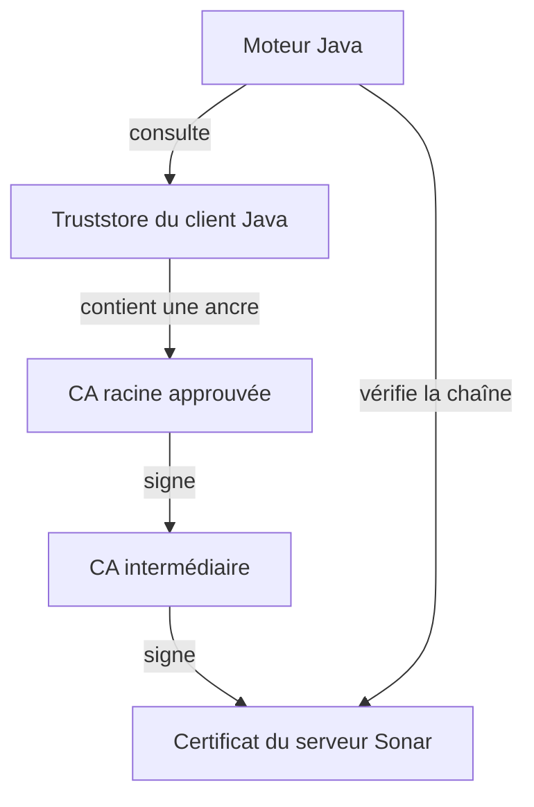
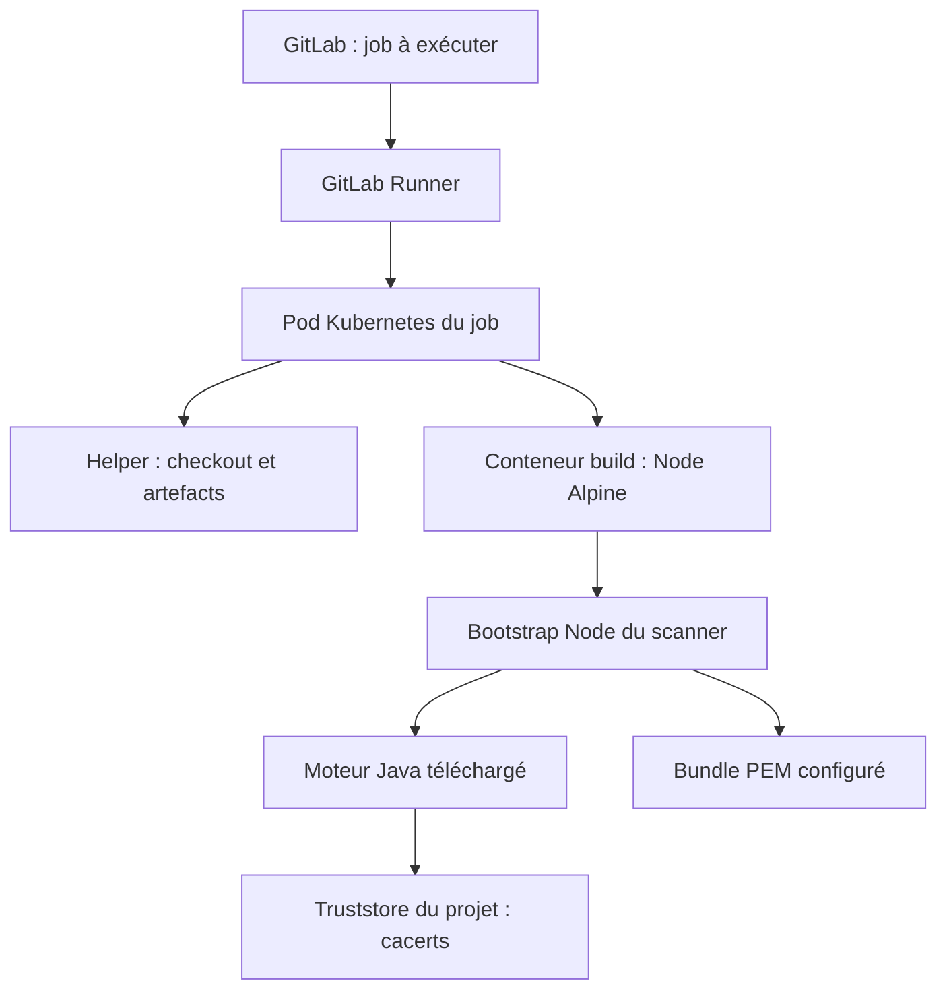

# Comprendre les certificats TLS dans les pipelines CI/CD

## Un cours progressif à partir du problème Sonar de SQUID

Date : 27 octobre 2026. Public : développeur ou tech lead découvrant les certificats. Les chemins SQUID proviennent des captures fournies ; les exemples `entreprise.example` sont fictifs. Ce document explique et propose une démarche : aucune correction du pipeline n’a été exécutée ici.

## Parcours conseillé

1. Lire les parties 1 à 5 pour comprendre le vocabulaire.
2. Lire les parties 6 à 9 pour comprendre les emplacements et les jobs.
3. Utiliser les parties 10 à 13 pour traiter l’incident.
4. Garder les commandes et le glossaire comme aide-mémoire.

---

## 1. La réponse à ta question principale

**Pour appeler SonarQube en HTTPS, ton runner n’a normalement pas à générer un certificat serveur.** SonarQube, ou le composant qui expose son URL HTTPS, présente son certificat. Le programme client dans le job doit pouvoir vérifier ce certificat grâce à des autorités de confiance.

Il y a trois actions différentes :

| Action | Exemple | Responsable habituel |
|---|---|---|
| Émettre un certificat | Signer le certificat du service Sonar | Autorité de certification / équipe PKI |
| Installer le certificat serveur | Configurer certificat, clé privée et intermédiaires sur le reverse proxy | Équipe qui exploite le point d’entrée HTTPS |
| Distribuer les autorités de confiance | Fournir les certificats CA aux images et aux applications | PKI, plateforme, puis équipe applicative selon le mode de distribution |

Le pipeline peut **construire un fichier truststore à partir de certificats CA déjà approuvés**. Cela ne signifie pas qu’il crée une autorité de certification ou qu’il renouvelle le certificat de SonarQube.

Exemple concret : l’équipe PKI fournit `racine-entreprise.crt`. L’équipe plateforme le distribue. Ton application Java le charge dans son truststore. Aucun de ces gestes ne remplace le certificat installé sur le serveur.

## 2. À quoi sert HTTPS / TLS ?

HTTP décrit les échanges applicatifs : demander une page, appeler une API, envoyer un rapport. HTTPS transporte ces échanges dans une connexion protégée par TLS.

TLS vise notamment à :

- vérifier l’identité du service auquel on se connecte ;
- protéger la confidentialité des données échangées ;
- détecter les altérations pendant le transport.

Le client ne doit pas seulement pouvoir joindre une adresse réseau. Il doit vérifier qu’il communique avec le service attendu. Un certificat contribue à cette vérification.

Dans ton job, le **client** est le moteur Java du scanner. Le **serveur** est le point d’entrée HTTPS de SonarQube. Ce serveur peut être un reverse proxy devant SonarQube plutôt que le processus SonarQube lui-même.

L’erreur TLS arrive avant que le moteur puisse exploiter la réponse de l’API. Corriger le code Angular ou le rapport de couverture ne résout donc pas cette erreur de connexion.

## 3. Certificat, clés et autorité : les notions de base

### 3.1 Un certificat est une attestation numérique

Un certificat X.509 associe notamment une identité à une clé publique. Il comporte une signature de son émetteur.

| Champ | Signification | Exemple fictif |
|---|---|---|
| Subject | Identité du titulaire | Service Sonar de l’entreprise |
| Issuer | Identité de l’autorité qui l’a signé | Entreprise Issuing CA 02 |
| SAN | Noms DNS ou adresses autorisés | `sonar.entreprise.example` |
| Not Before / Not After | Période de validité | Début et fin de validité |
| Serial Number | Numéro attribué par l’émetteur | Identifiant du certificat |
| Public Key | Clé publique liée à l’identité | Clé RSA ou EC |
| Signature | Signature de l’émetteur | Permet de vérifier l’attestation |
| Basic Constraints | Indique notamment si le certificat est celui d’une CA | `CA:TRUE` pour une autorité |

L’empreinte SHA-256 est un condensat calculé sur le certificat. Elle sert à comparer précisément deux certificats. Deux certificats peuvent avoir des noms ressemblants et des empreintes différentes.

### 3.2 Clé publique et clé privée

La clé publique est partageable. La clé privée doit rester protégée chez son propriétaire. Le serveur utilise sa clé privée dans l’établissement de la connexion TLS pour prouver qu’il possède la clé correspondant à son certificat.

**Ton job Sonar n’a pas besoin de la clé privée du serveur SonarQube.** Il doit recevoir le certificat public du serveur pendant la connexion et disposer des autorités de confiance nécessaires.

Le certificat n’est pas un token Sonar. Un token répond à la question « as-tu le droit de faire cette analyse ? ». La validation du certificat répond à « à quel serveur suis-je connecté et puis-je vérifier son identité ? ».

### 3.3 CA et PKI

CA signifie *Certificate Authority*, en français **autorité de certification**. Une CA signe des certificats. PKI signifie *Public Key Infrastructure* : l’ensemble des autorités, procédures, outils et responsabilités de gestion des certificats.

La PKI gère notamment les demandes, les validations, l’émission, le renouvellement et la révocation. Les certificats publics des CA sont distribués aux clients par des canaux approuvés. Les clés privées des CA restent fortement protégées.

### 3.4 Racine et intermédiaire

Une CA racine constitue généralement une ancre de confiance installée à l’avance chez le client. Une CA intermédiaire est autorisée par une autre CA à émettre des certificats. On limite ainsi l’usage direct de la clé racine.



Le serveur présente habituellement son certificat et les intermédiaires nécessaires. La racine n’est généralement pas envoyée : le client doit déjà lui faire confiance. Recevoir un certificat racine du réseau ne suffit pas à le rendre digne de confiance.

## 4. Comment Java décide si la connexion est acceptable

Voici un déroulement simplifié d’une connexion HTTPS :

1. Le client contacte l’hôte attendu, éventuellement via un proxy.
2. Le serveur présente son certificat et une chaîne d’intermédiaires.
3. Le client cherche un chemin de certification vers une ancre approuvée.
4. Il vérifie les signatures, les contraintes et les dates applicables ; la vérification du nom DNS doit également réussir.
5. Si les contrôles requis passent, l’échange applicatif peut continuer.

La vérification de révocation dépend du client et de sa configuration ; elle n’est pas nécessairement activée partout.

**`PKIX path building failed`** signifie que le validateur n’a pas réussi à construire un chemin de certification acceptable. Cela oriente vers les certificats et la confiance. Cela ne dit pas, à lui seul, quel certificat manque ni quelle équipe est responsable.

Exemple : Java fait confiance à « Racine A », mais le service présente maintenant un certificat rattaché à « Racine B ». Même URL, même code, mêmes versions : la connexion peut échouer.

Autre exemple : la racine est correcte, mais le serveur a cessé de transmettre un intermédiaire. La chaîne peut devenir impossible à reconstruire.

## 5. PEM, DER, JKS, PKCS#12, cacerts : ne plus les confondre

### 5.1 Format, rôle et nom de fichier sont trois choses différentes

| Terme | Nature | À retenir |
|---|---|---|
| X.509 | Structure d’un certificat | Définit les informations du certificat |
| PEM | Représentation textuelle avec balises | Peut contenir certificat, clé ou autre objet selon les balises |
| DER | Encodage binaire | Souvent utilisé pour un certificat individuel |
| JKS | Format historique de magasin Java | Peut stocker certificats de confiance ou clés selon ses entrées |
| PKCS#12 | Format de conteneur interopérable | Extensions fréquentes `.p12` et `.pfx` |
| Truststore | Rôle : magasin de confiance | Contient les éléments approuvés pour vérifier les correspondants |
| Keystore | Magasin de clés/certificats ; terme aussi utilisé au sens large dans Java | Pour l’identité TLS, contient typiquement une clé privée et sa chaîne |
| `cacerts` | Nom de fichier courant | Ne garantit pas le format réel ni le contenu |
| CA bundle | Ensemble de certificats CA | Souvent plusieurs certificats PEM concaténés |

Le mot **truststore** décrit l’usage. **JKS** et **PKCS#12** décrivent des formats. Un truststore peut être au format JKS ou PKCS#12. Une extension `.crt` ou `.cer` ne suffit pas non plus à déduire l’encodage.

### 5.2 Exemple de PEM

```text
-----BEGIN CERTIFICATE-----
...données encodées en base64...
-----END CERTIFICATE-----
```

Un bundle peut enchaîner plusieurs blocs de ce type. `trusty_bundle.pem` est un nom choisi par le projet, pas un nom standard imposé par TLS.

Un bloc `BEGIN PRIVATE KEY` contient un autre type d’objet : il ne doit pas être traité comme un simple certificat public à distribuer.

### 5.3 Le mot de passe du magasin

Le mot de passe d’un truststore n’est ni le token Sonar ni une clé privée du serveur. Il sert à la protection du magasin selon son format. Un magasin qui ne contient que des certificats publics reste sensible du point de vue de son intégrité : ajouter une mauvaise CA modifie les identités auxquelles le programme fait confiance.

### 5.4 Ce qu’une conversion peut et ne peut pas faire

Convertir JKS vers PKCS#12 change le conteneur. **Cela n’ajoute pas une autorité absente.** Renommer `cacerts` en `truststore.p12` ne convertit rien. La bonne démarche est de vérifier d’abord le contenu et le besoin du client.

## 6. Où se trouve le truststore ?

Il n’existe pas un emplacement unique universel. Chaque programme peut utiliser sa propre source de confiance.

| Environnement | Emplacement ou mécanisme fréquent | Limite à connaître |
|---|---|---|
| Java, configuration par défaut | Sous le Java actif : `lib/security/cacerts`, avec prise en compte possible de `jssecacerts` | Le Java actif peut être téléchargé par le scanner |
| Java, configuration explicite | Chemin fourni par `javax.net.ssl.trustStore` | Ce chemin peut être dans le dépôt ou un volume |
| Node.js | Autorités intégrées et, selon la configuration, fichier PEM supplémentaire | Ce n’est pas automatiquement le magasin Java |
| Debian/Ubuntu/Alpine | Bundle système souvent sous `/etc/ssl/certs/` | Les applications ne le consultent pas toutes |
| Windows | Magasins de certificats utilisateur/machine | Java peut utiliser son propre magasin malgré Windows |
| Conteneur de job | Fichiers présents dans l’image, le checkout ou les volumes | Le magasin du PC développeur n’y est pas automatiquement copié |

Pour JSSE standard, une propriété `javax.net.ssl.trustStore` explicite sélectionne le magasin ; sans elle, les fichiers par défaut du Java actif sont recherchés. Une bibliothèque peut cependant créer sa propre configuration TLS. Il faut donc regarder les options effectives du programme, pas seulement les fichiers disponibles. [S1]

### Dans ton projet

Le chemin observé est de la forme :

```text
/builds/grc-cacib/aifactory/projects/squid-ai/squid-frontend/
  SquidAIFrontend/certs/cacerts
```

Cette arborescence correspond au répertoire du projet dans le conteneur du job. Avec :

```yaml
JAVA_TOOL_OPTIONS: "-Djavax.net.ssl.trustStore=$CI_PROJECT_DIR/$MODULE_NAME/certs/cacerts"
```

Java est orienté vers ce fichier du projet. **Mettre à jour uniquement les certificats du serveur hébergeant le runner ne garantit donc pas de corriger ce job.** Il faut mettre à jour la source effectivement utilisée, ou réparer la chaîne présentée par le service si elle est incorrecte.

Le nom `cacerts` ne prouve pas le format JKS. Copilot indique l’avoir identifié comme tel ; cela reste un résultat rapporté par ses captures, pas une inspection binaire effectuée dans ce cours.

## 7. Runner, Kubernetes, conteneur et moteur Java

### 7.1 Les couches à distinguer

Le runner reçoit un job GitLab et organise son exécution. Avec l’exécuteur Kubernetes, le travail est effectué dans un pod contenant notamment les conteneurs nécessaires au job. Le script s’exécute dans l’image choisie par la CI.



Le helper, le système du conteneur et Java peuvent utiliser des configurations TLS différentes. GitLab distingue explicitement la confiance nécessaire au runner/helper de celle des scripts exécutés dans l’image utilisateur. [S2]

Conséquence pour toi : **« le clone Git réussit » ne prouve pas « Java peut valider SonarQube ».** Les connexions, les services et les magasins ne sont pas les mêmes.

### 7.2 Les fichiers sont souvent temporaires

Le checkout du dépôt recrée les fichiers versionnés dans le job. Les volumes peuvent fournir d’autres fichiers. Quand le pod disparaît, une modification faite uniquement dans son système de fichiers n’est généralement pas durable.

Pour conserver un correctif, il faut modifier sa source : dépôt approuvé, image de base, variable de type fichier ou configuration du volume, selon l’architecture retenue.

## 8. Comment les certificats sont obtenus et distribués

### 8.1 Côté serveur : le cycle de vie

Un processus habituel est : création ou gestion d’une paire de clés ; préparation d’une demande de signature (CSR) ; validation par la PKI ; émission du certificat ; installation avec la chaîne et la clé privée sur le point d’entrée HTTPS ; renouvellement avant expiration.

Cela peut être manuel ou automatisé avec une plateforme PKI, un gestionnaire de certificats ou des contrôleurs Kubernetes. Un pipeline peut participer à cette automatisation, mais ce n’est pas ce que montre ton job Sonar.

### 8.2 Côté client : les autorités sont fournies par un canal de confiance

On obtient habituellement les certificats CA auprès de la PKI interne, d’un portail infrastructure, d’un paquet officiel de certificats d’entreprise ou d’une image de base maintenue par la plateforme.

On peut aussi **observer** le certificat servi via OpenSSL ou le navigateur. Observer ne signifie pas approuver : avant d’ajouter une autorité, il faut vérifier sa provenance et son empreinte auprès de la source officielle.

### 8.3 Quatre modes de distribution dans les jobs

| Mode | Exemple | Qui maintient ? | Conséquence d’un renouvellement de CA |
|---|---|---|---|
| Dépôt Git | `SquidAIFrontend/certs/cacerts` | Équipe projet avec la PKI | Commit de mise à jour revu |
| Image de base | Image interne contenant les autorités | Équipe plateforme | Nouvelle image puis adoption par les jobs |
| Variable CI/CD de type fichier | Variable donnant le chemin d’un fichier temporaire | Administrateurs projet/groupe | Mise à jour centralisée de la variable |
| Volume Kubernetes | Fichier monté dans le conteneur | Équipe plateforme/runner | Mise à jour de la ressource et vérification des nouveaux jobs |

Un certificat CA public n’est pas une clé privée. Il peut être versionné si la politique interne l’autorise. En revanche, les clés privées et tokens ne doivent pas être ajoutés au dépôt. Un objet Kubernetes Secret est un mécanisme de distribution ; son nom ne signifie pas que chaque certificat qu’il contient est secret.

Dans ton cas, les captures orientent vers le premier mode pour `cacerts`. Demander à la plateforme le mode officiel de distribution évite de créer une copie locale difficile à maintenir.

## 9. Les variables de ton pipeline, expliquées

| Variable / option | Fonction | Ce qu’elle ne garantit pas |
|---|---|---|
| `CI_PROJECT_DIR` | Répertoire du checkout dans le job | N’est pas le répertoire de ton PC |
| `MODULE_NAME` | Sous-dossier applicatif, ici `SquidAIFrontend` | N’est pas une option TLS |
| `NODE_EXTRA_CA_CERTS` | Ajoute des certificats PEM à la confiance Node lors de son démarrage | Ne configure pas le truststore Java |
| `JAVA_TOOL_OPTIONS` | Fournit des options à la JVM | Ne vérifie pas à lui seul le contenu du fichier indiqué |
| `javax.net.ssl.trustStore` | Chemin d’un magasin pour JSSE | Ne crée pas le fichier |
| `javax.net.ssl.trustStoreType` | Type du magasin, si explicitement configuré | N’effectue pas de conversion |
| `SONAR_SCANNER_OPTS` dans ton script | Variable développée en arguments après `npx` | Son effet dépend de la commande qui l’utilise |
| `sonar.scanner.truststorePath` | Configuration de magasin propre aux scanners récents | Nécessite un magasin préparé et compatible |
| `http_proxy`, `https_proxy`, `no_proxy` | Informations de proxy pour les outils qui les prennent en charge | Tous les clients Java ne les interprètent pas automatiquement |
| `npm config set cafile` | Source CA configurée pour npm | Ne configure pas Java |

Node lit `NODE_EXTRA_CA_CERTS` au lancement. Un client configurant explicitement sa propre option `ca` peut avoir un comportement différent. [S3]

La ligne `Picked up JAVA_TOOL_OPTIONS` montre la réception d’une option. Même si elle est préfixée `[ERROR]` par le bootstrap, elle existait aussi dans le job réussi : **ce n’est pas l’exception fatale**.

De même, `test -s certs/cacerts` vérifie seulement présence et taille non nulle. Ce n’est ni un test de format ni une vérification de chaîne.

### Exemple de configuration Java, à titre pédagogique

```yaml
sonar_check:
  variables:
    NODE_EXTRA_CA_CERTS: "$CI_PROJECT_DIR/SquidAIFrontend/certs/trusty_bundle.pem"
    JAVA_TOOL_OPTIONS: "-Djavax.net.ssl.trustStore=$CI_PROJECT_DIR/SquidAIFrontend/certs/cacerts"
  script:
    - cd "$CI_PROJECT_DIR/SquidAIFrontend"
    - test -s certs/cacerts
    - npx -y @sonar/scan@5.0.2 $SONAR_SCANNER_OPTS
```

Ce fragment ne remplace pas le job complet : il illustre les chemins, avec le registre, le proxy et les autres paramètres déjà configurés par ailleurs. L’épinglage de version sert à la reproductibilité, pas à réparer un certificat manquant.

### Autre voie : configuration PKCS#12 explicite du scanner

Pour NPM récent, Sonar documente un magasin PKCS#12 et les options `sonar.scanner.truststorePath` et `sonar.scanner.truststorePassword`. [S4]

```yaml
script:
  - >
    npx -y @sonar/scan@5.0.2
    $SONAR_SCANNER_OPTS
    -Dsonar.scanner.truststorePath="$CI_PROJECT_DIR/SquidAIFrontend/certs/truststore.p12"
    -Dsonar.scanner.truststorePassword="$SONAR_TRUSTSTORE_PASSWORD"
```

Préconditions : fichier existant, CA approuvées présentes, mot de passe correspondant, autres paramètres Sonar conservés. Une migration doit choisir clairement sa configuration et traiter les anciens réglages devenus inutiles. **Ce n’est pas le premier changement à pousser pour cet incident**, puisque l’ancien magasin fonctionnait.

## 10. Proxy : pourquoi le chemin réseau compte

Deux situations sont possibles :

1. **Proxy tunnel** : il transporte la connexion, et le client voit le certificat du service distant.
2. **Proxy avec inspection TLS** : il termine une connexion TLS et en établit une autre ; le client peut voir un certificat signé par une CA d’inspection d’entreprise.

Il ne faut pas supposer que votre proxy intercepte TLS : il faut le vérifier. De même, configurer le proxy de npm ne prouve pas que le moteur Java utilise exactement ce trajet.

Un navigateur sur ton PC peut réussir alors que le runner échoue : magasins différents, réseau différent, proxy différent, ou autre point d’entrée. Un test utile doit reproduire autant que possible le réseau et le trajet du client en erreur.

Un load balancer répartit les connexions entre plusieurs serveurs. Si tous ne présentent pas la même chaîne, on peut obtenir des résultats variables. L’URL affichée dans un lien de tableau de bord Sonar peut être une URL publique configurée ; elle ne prouve pas à elle seule une redirection de l’appel API.

## 11. Application à ton incident : faits et hypothèses

### Ce que montrent directement les logs fournis

- Le build passe et les artefacts sont téléchargés.
- Le bootstrap NPM détecte SonarQube et télécharge le JRE et le moteur.
- Les essais comparés affichent Node 22.22.0, npm 10.9.4, scanner 5.0.2, SonarQube 2026.1.2 et Java 21.0.9.
- L’ancien succès passe `Load global settings`, analyse les sources et termine avec succès.
- L’essai récent échoue sur `/sonarqube/api/settings/values.protobuf` avec une erreur de chaîne TLS et `PKIX path building failed`.
- Le chemin `certs/cacerts` est transmis à Java dans les deux cas.

### Ce qu’ajoutent les captures de la discussion Copilot

Tu y indiques avoir relancé aussi l’ancien job réussi et obtenu un échec. Copilot rapporte avoir comparé les fichiers CI, certificats et manifests concernés entre les commits, avec des objets Git identiques. Ce sont des éléments très utiles ; conserver les sorties de comparaison et le log brut permet d’en garder une preuve exploitable.

Cela renforce la piste d’un changement externe au dépôt. **Cela ne fige pas tout l’environnement** : les variables CI, le réseau, une image référencée par un tag, les points d’entrée ou la configuration de la plateforme peuvent évoluer.

### Hypothèses à départager

| Hypothèse | Preuve à rechercher | Correction possible après confirmation |
|---|---|---|
| Nouvelle CA ou nouvelle chaîne côté HTTPS | Émetteurs, empreintes et historique PKI | Distribuer les autorités approuvées nécessaires |
| Intermédiaire manquant côté serveur | Chaîne présentée incomplète | Réparer la chaîne au point d’entrée HTTPS |
| Changement de proxy / inspection | Émetteur différent selon le trajet | Aligner routage et confiance avec la configuration officielle |
| Nœuds incohérents | Chaînes différentes selon IP/pod/essai | Harmoniser les points de terminaison |
| Configuration effective du client modifiée | Diff de variables, image, options, volumes | Corriger la configuration concernée |
| Expiration | Dates et erreur de validation détaillée | Renouveler le composant concerné |

Un renouvellement du seul certificat serveur sous une chaîne déjà approuvée ne devrait normalement pas imposer une mise à jour du client. Il peut casser un client si celui-ci ne faisait confiance qu’à l’ancien certificat serveur, ou si la chaîne réellement présentée change.

Les avertissements de couverture LCOV et de rapports Dependency-Check de l’ancien succès sont un autre sujet. Ils n’expliquent pas l’échec TLS avant analyse.

## 12. Qui contacter, et pour demander quoi ?

**Commence par l’équipe qui exploite la plateforme SonarQube / Code Quality, avec l’équipe GitLab Runner ou plateforme CI en copie si tu connais le contact.** Si tu ignores le circuit, demande au tech lead le bon support. Les noms exacts et les responsabilités internes ne sont pas visibles dans les captures.

| Équipe | Rôle utile pour cet incident |
|---|---|
| Sonar / Code Quality | Vérifier le point d’entrée HTTPS, les changements récents et la chaîne servie |
| Plateforme CI / runners / Kubernetes | Reproduire depuis le réseau du job, identifier image, volumes et environnement |
| Réseau / proxy | Confirmer le trajet, l’inspection éventuelle et les changements de proxy |
| PKI / certificats | Identifier les CA légitimes, confirmer les empreintes et fournir le bundle officiel |
| Équipe SQUID | Vérifier le truststore du dépôt, appliquer le correctif applicatif nécessaire et valider |

« Contacter l’infra » ne signifie donc pas « les certificats sont générés par les runners ». Cela signifie qu’elle peut observer et administrer des couches auxquelles tu n’as pas forcément accès.

### Message prêt à adapter

> Bonjour, le job `sonar_check` de `squid-frontend` échoue sur la validation TLS lors de l’appel à `https://cacib.code.quality.cagip.group.gca/sonarqube/api/settings/values.protobuf` : `SSLHandshakeException`, `The certificate chain is not trusted` et `PKIX path building failed`.
>
> Le job avait réussi la semaine dernière. Sa relance échoue désormais également ; les versions visibles du scanner et de Java sont identiques. Le moteur Java utilise le truststore du projet `SquidAIFrontend/certs/cacerts`.
>
> Pouvez-vous vérifier s’il y a eu un renouvellement de certificat, une modification de chaîne ou de proxy depuis le dernier succès ? Nous aurions besoin de la chaîne présentée depuis le réseau du runner `mais-kbgit-gitlab-runner`, avec le trajet réellement utilisé par le moteur Java : sujets, émetteurs, dates et empreintes SHA-256. Pouvez-vous également nous indiquer le bundle CA officiel à utiliser, ou nous orienter vers l’équipe PKI ? Merci.

Joindre les liens internes du job réussi historique et du job échoué, plus les dates exactes lues dans GitLab. Il n’est pas nécessaire de demander un mot de passe, un token ou une clé privée.

## 13. Comment avancer maintenant, sans se disperser

### Étape 1 — Conserver l’état connu

Garde le log réussi, le log de sa relance échouée et le log actuel. Note les commits et les horaires. Examine les changements locaux proposés par Copilot. Ne mélange pas un brouillon PKCS#12 non terminé avec le diagnostic de la configuration existante.

### Étape 2 — Ouvrir la demande au support

Utilise le message ci-dessus. Le résultat attendu n’est pas « essayez encore » mais la chaîne observée et le mode officiel de distribution des CA. L’équipe plateforme peut exécuter le diagnostic dans un environnement reproduisant le réseau du job.

### Étape 3 — Comparer chaîne et confiance

Avec les métadonnées du serveur et la liste des certificats du truststore, identifier l’ancre de confiance et les intermédiaires nécessaires. Ne comparer que les noms ne suffit pas : regarder aussi les empreintes, clés et liens de signature.

### Étape 4 — Choisir le bon emplacement de correction

- Chaîne serveur incomplète : correction par l’équipe du point d’entrée HTTPS.
- Nouvelle CA légitime absente du magasin projet : mise à jour du truststore approuvé par l’équipe SQUID, ou adoption du bundle central recommandé.
- Mauvais proxy : correction du trajet et des options effectives.
- Points d’entrée incohérents : correction de la plateforme.

### Étape 5 — Valider uniquement Sonar d’abord

Une modification de fichiers demande un nouveau commit et un nouveau pipeline pour être exécutée. Relancer un ancien job ne teste pas tes fichiers locaux modifiés. Vérifie que `Load global settings` passe, que l’analyse et l’envoi du rapport réussissent, puis le statut du Quality Gate si le pipeline l’attend. Un scan envoyé avec succès n’est pas automatiquement la preuve que le Quality Gate est vert.

### Étape 6 — Organiser la maintenance

Identifier le propriétaire du bundle, sa source, sa version et le processus de renouvellement. Pendant une rotation de CA, prévoir la coexistence nécessaire entre anciennes et nouvelles autorités suivant la politique PKI. Retirer les anciennes après validation et fin de transition, pas au hasard.

## 14. Commandes utiles et limites

Ces exemples sont pour Bash/Git Bash ou un terminal Linux, sauf indication contraire. Ils ne sont pas exécutés par ce document. Utiliser les outils déjà disponibles ou un environnement de diagnostic fourni par la plateforme.

### 14.1 Lire un certificat public

```bash
openssl x509 -in certificat.pem -noout -subject -issuer -dates -fingerprint -sha256
```

Cette commande concerne un certificat. Pour un bundle, examiner chaque certificat séparément ; une seule invocation ne décrit pas nécessairement tous les blocs.

### 14.2 Lister le magasin du projet

```bash
keytool -list -v -keystore SquidAIFrontend/certs/cacerts
```

`keytool` provient du JDK. Le mot de passe demandé est celui du magasin. Ne pas supposer qu’il est `changeit` et ne pas l’envoyer dans une conversation. Le résultat permet d’identifier le type du magasin et les entrées. Une entrée de confiance est généralement indiquée comme `trustedCertEntry`. [S5]

### 14.3 Comparer les fichiers versionnés

Remplacer `COMMIT_SUCCES` par le SHA confirmé du job historique :

```bash
git diff COMMIT_SUCCES 62af1e38 -- .gitlab-ci.yml ci-templates/.gitlab-ci-dev.yml SquidAIFrontend/certs/
git rev-parse COMMIT_SUCCES:SquidAIFrontend/certs/cacerts
git rev-parse 62af1e38:SquidAIFrontend/certs/cacerts
```

Deux identifiants d’objet Git identiques pour le fichier indiquent un contenu versionné identique. Cela ne prouve pas qu’aucun script, artefact ou volume ne l’écrase lors de l’exécution. Pour comparer les fichiers réellement présents, on peut calculer leurs SHA-256 dans les jobs.

Sous PowerShell, pour un fichier local :

```powershell
Get-FileHash -Algorithm SHA256 .\SquidAIFrontend\certs\cacerts
```

### 14.4 Observer la chaîne via le trajet confirmé

Connexion directe, seulement si c’est le trajet utilisé :

```bash
openssl s_client \
  -connect cacib.code.quality.cagip.group.gca:443 \
  -servername cacib.code.quality.cagip.group.gca \
  -showcerts </dev/null
```

Via un proxy HTTP CONNECT confirmé par la plateforme :

```bash
openssl s_client \
  -proxy PROXY_HOTE:PORT \
  -connect cacib.code.quality.cagip.group.gca:443 \
  -servername cacib.code.quality.cagip.group.gca \
  -showcerts </dev/null
```

`-connect` désigne la destination ; `-servername` transmet le nom SNI ; `-showcerts` affiche les certificats envoyés. Ce n’est pas une chaîne forcément validée. Le proxy réel et son éventuelle authentification doivent être déterminés, pas devinés. [S6]

Ce test observe TLS ; il n’envoie pas le token Sonar. Un succès OpenSSL ne prouve pas que le truststore Java réussira : les sources de confiance peuvent différer.

### 14.5 Construire un nouveau magasin après validation PKI

Exemple pédagogique : importer une CA approuvée dans un nouveau fichier, sans écraser le magasin actuel :

```bash
keytool -importcert \
  -alias entreprise-racine-validee \
  -file racine-entreprise-approuvee.pem \
  -keystore truststore-test.p12 \
  -storetype PKCS12
```

Vérifier l’empreinte avant de confirmer. Importer chaque autorité supplémentaire requise avec un alias distinct, selon le choix PKI. Ne pas importer aveuglément tout ce qu’un serveur présente. Le mot de passe est demandé interactivement ; sa gestion CI doit ensuite suivre le mécanisme prévu.

## 15. Erreurs fréquentes

| Confusion | Correction |
|---|---|
| « Le runner génère le certificat de Sonar » | Il exécute le client ; le certificat serveur vient du processus PKI du service |
| « JKS signifie certificat » | JKS est un format de magasin |
| « Le truststore est toujours dans Java » | Il peut être placé ailleurs et sélectionné par un chemin |
| « Windows fait confiance, donc le conteneur aussi » | Les environnements ont leurs propres configurations |
| « Le fichier existe, donc la chaîne est valide » | Présence, format, contenu et validation sont des contrôles distincts |
| « Le certificat a changé, il faut toujours l’importer » | Un renouvellement sous la même chaîne approuvée peut fonctionner sans modification client |
| « `strict-ssl false` corrige Java » | Cette option npm ne répare pas la confiance Java |
| « Il faut désactiver TLS pour débloquer » | Il faut réparer la confiance ou la chaîne présentée |
| « PKCS#12 ajoutera l’autorité manquante » | Un changement de format ne crée pas les certificats absents |
| « Même commit signifie environnement identique » | Variables, réseau, images et services externes peuvent changer |

## 16. Petit glossaire pour les réunions

| Expression entendue | Sens simple |
|---|---|
| Certificate authority / CA | Autorité qui signe des certificats |
| Trusted CA | Autorité acceptée par le client |
| Trust anchor | Point de confiance à partir duquel on valide une chaîne |
| Truststore | Fichier ou magasin des éléments approuvés |
| Certificate chain | Ensemble de certificats reliant le service à une autorité approuvée |
| Leaf certificate | Certificat final du service |
| Intermediate CA | Autorité intermédiaire |
| Root CA | Autorité racine |
| Keystore | Magasin de clés et/ou certificats |
| CSR | Demande de signature de certificat |
| Renewal / rotation | Renouvellement / remplacement organisé |
| Issuer | Émetteur du certificat |
| Fingerprint | Empreinte numérique du certificat |
| TLS handshake | Phase d’établissement et de vérification TLS |
| TLS termination | Endroit où une connexion TLS est terminée, par exemple le reverse proxy |
| Ingress / reverse proxy | Composant pouvant exposer un service Kubernetes en HTTPS |
| JRE / JVM | Environnement Java / machine virtuelle exécutant le code |
| PKIX | Règles et mécanismes de validation des certificats X.509 |

## 17. Vérifier que tu as compris

**Pourquoi le clone Git peut-il réussir et Sonar échouer ?** Parce que les clients, les services contactés et les magasins de confiance peuvent différer.

**Qui fournit la bonne CA interne ?** La PKI ou le canal officiel de la plateforme. L’équipe du projet l’intègre selon le mode retenu.

**Où est le magasin Java dans notre cas ?** Dans le chemin du checkout `SquidAIFrontend/certs/cacerts` indiqué par l’option JVM, sous réserve d’une configuration supplémentaire du scanner.

**Doit-on générer une nouvelle clé privée pour réparer le client Sonar ?** Non, pas pour la validation du serveur observée ici. Le TLS mutuel serait un autre besoin, non démontré par ces logs.

**Quel est le prochain résultat à obtenir ?** La chaîne présentée depuis le réseau du job et le bundle officiel, puis une comparaison avec les autorités présentes dans le magasin.

## Sources officielles et périmètre

Les explications et exemples pédagogiques sont adaptés au cas fourni. Les captures montrent les symptômes ; elles ne révèlent pas la configuration privée des équipes infrastructure. Les références ci-dessous servent à vérifier les mécanismes et commandes, pas à prétendre connaître cette infrastructure.

- [S1 — Oracle : JSSE Reference Guide, Java 21](https://docs.oracle.com/en/java/javase/21/security/java-secure-socket-extension-jsse-reference-guide.html)
- [S2 — GitLab : certificats personnalisés, runners et conteneurs](https://docs.gitlab.com/runner/configuration/tls-self-signed/)
- [S3 — Node.js : NODE_EXTRA_CA_CERTS](https://nodejs.org/api/cli.html#node_extra_ca_certsfile)
- [S4 — SonarSource : gestion des certificats TLS côté scanner](https://docs.sonarsource.com/sonarqube-server/analyzing-source-code/scanners/scanner-environment/manage-tls-certificates)
- [S5 — Oracle : commande keytool](https://docs.oracle.com/en/java/javase/21/docs/specs/man/keytool.html)
- [S6 — OpenSSL : commande s_client](https://docs.openssl.org/3.5/man1/openssl-s_client/)

Pour l’incident actuel, la priorité reste d’identifier la différence de chaîne ou de configuration entre le succès historique et l’échec actuel, puis de corriger au bon endroit.
